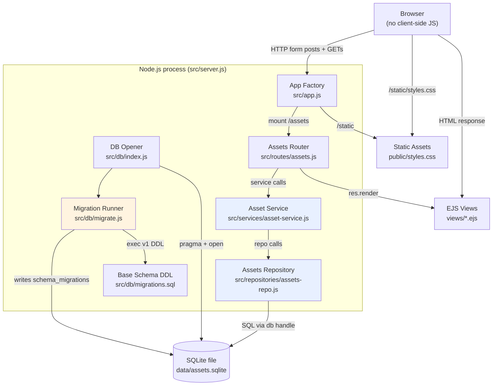
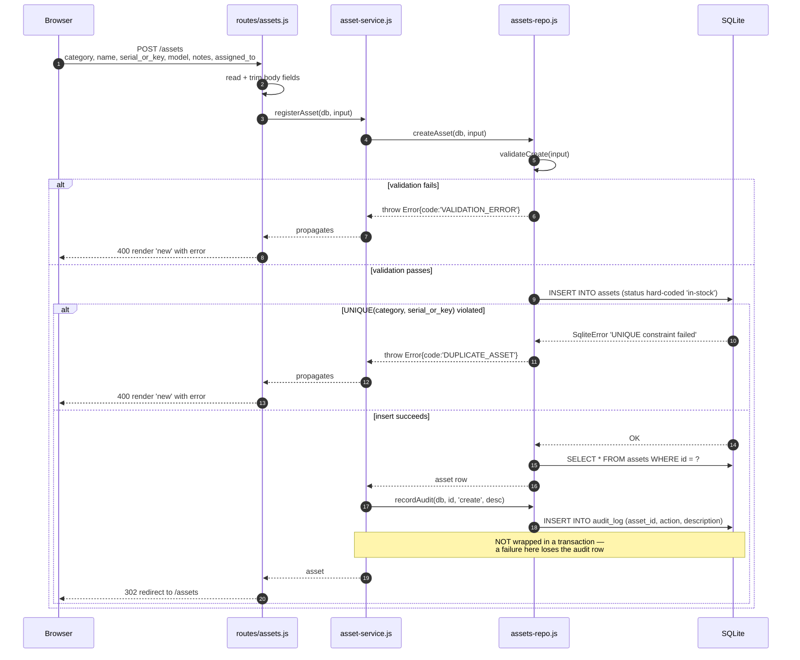
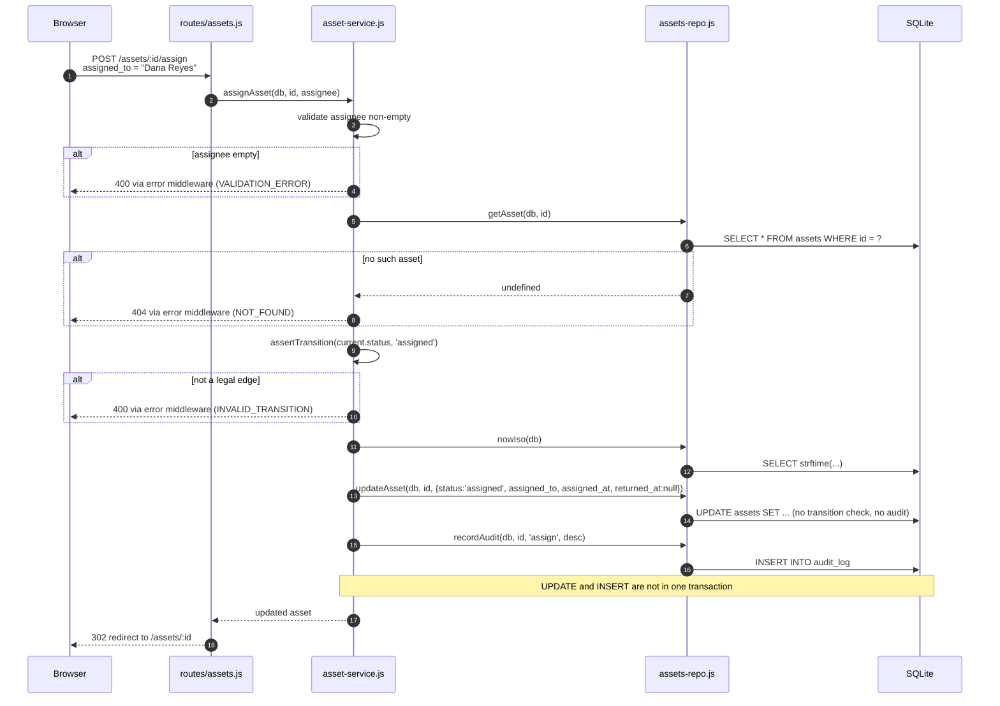
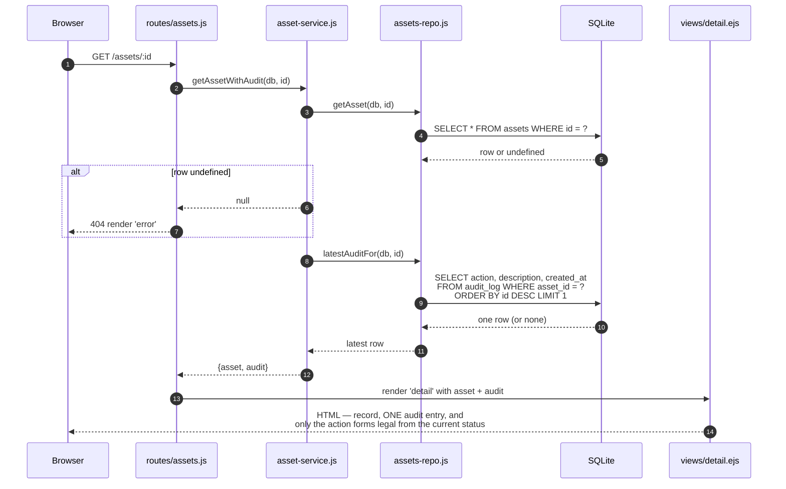
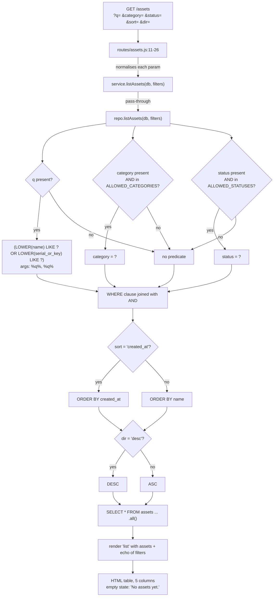

# Architecture

## Architecture Analysis

### System Overview

`assets_management` is a **single-process, server-rendered monolithic web
application**. One Node.js process serves an Express HTTP layer, renders EJS
templates, and reads/writes a single local SQLite database file through a
synchronous driver. There is no client-side JavaScript, no JSON API, no
background worker, no message broker, no cache, and no outbound network call of
any kind.

The whole system is seven JavaScript modules under `src/` plus six EJS
templates, and it is fully synchronous end to end: the HTTP request blocks on
the SQLite write and the response is rendered before it returns. There is no
loading state anywhere because there is nothing to wait for asynchronously.

### Architectural Style

**Monolith** — specifically a layered monolith with a classic three-tier
split. The evidence:

- One process, one entry point (`src/server.js`), one port
  (`src/server.js:8`, `PORT` env var, default 3000).
- One database, one file, accessed through one handle (`src/db/index.js:14`).
- Strictly layered `require` edges with no cycles
  (see [dependencies.md](dependencies.md) § Internal Dependency Graph):
  `routes → services → repositories → db`.
- No network boundary anywhere: no `fetch`, no `axios`, no client SDK, no
  message queue, no service discovery, no container definition.

Layering is real rather than nominal: the router never touches SQL, the
repository never contains business rules, and the database module never knows
about HTTP.

### Component Relationships



The `SQL` node is a **file**, not a runtime service: `src/db/migrate.js:6`
reads `migrations.sql` once at module load and applies it as migration v1.

### Interaction Diagrams

This section shows how business transactions are actually implemented across the
components. Every diagram below is derived from the code, not from a design
document.

#### Transaction 1 — Register an asset (`POST /assets`)



Two properties of this flow matter for the MVP:

- The `INSERT` and the audit `INSERT` are **two separate statements with no
  enclosing transaction** (`src/services/asset-service.js:38-48`). `better-sqlite3`
  is synchronous, so a throw between them leaves the asset persisted with no
  audit row.
- Duplicate detection is **post-hoc and message-matched**: the repository
  string-matches `'UNIQUE constraint failed'` in the SQLite error message
  (`src/repositories/assets-repo.js:70`). It cannot distinguish the
  category-scoped violation from any other unique violation, and it says nothing
  about which column conflicted.

#### Transaction 2 — Assign an asset (`POST /assets/:id/assign`)



Note where the state machine actually lives: `assertTransition` is called by the
**service**, and the repository's `updateAsset` performs no validation of its
own. The state machine is enforced by *call discipline*, not by a layer
boundary — see [code-quality-assessment.md](code-quality-assessment.md) §
Technical Debt, item 5.

#### Transaction 3 — Read the asset detail page (`GET /assets/:id`)



The `LIMIT 1` at `src/repositories/assets-repo.js:121` is the entire history
retrieval surface. There is no full-history query anywhere in the codebase.

#### Transaction 4 — List and filter assets (`GET /assets`)



Two behaviours worth recording because they are easy to misread as
deliberate:

- The `category` and `status` filters are **silently dropped** when the value is
  not in the allowed set (`src/repositories/assets-repo.js:20-27`). An unknown
  `?status=whatever` returns the *unfiltered* list, not an empty list.
- The sort column and direction are **whitelisted, not parameterised**
  (`src/repositories/assets-repo.js:29-30`; the router applies the same
  whitelisting at `src/routes/assets.js:15-16`). There is no SQL injection
  surface here, which is correct.

There is **no `COUNT` query and no result count anywhere** on this path. The
list view renders every matching row with no pagination and no total.

#### Transaction 5 — Database open and migration (`openDatabase`)

```mermaid
sequenceDiagram
    autonumber
    participant S as server.js
    participant O as db/index.js
    participant M as db/migrate.js
    participant DB as SQLite file
    participant SQLF as migrations.sql

    S->>O: openDatabase(dbPath)
    O->>O: if not ':memory:' → mkdir -p dirname
    O->>DB: new Database(filename)
    O->>DB: PRAGMA journal_mode = WAL
    O->>DB: PRAGMA foreign_keys = ON
    Note over O: busy_timeout is NEVER set —<br/>the driver default applies
    O->>M: applyMigrations(db)
    M->>DB: CREATE TABLE IF NOT EXISTS schema_migrations
    M->>DB: SELECT version FROM schema_migrations
    loop for each migration not yet applied
        M->>M: db.transaction(() => { migration.up(db); INSERT INTO schema_migrations })
        Note over M: v1 → exec(migrations.sql)<br/>v2 → addColumnIfMissing(assigned_at, returned_at)
        M->>DB: run()
    end
    M-->>O: db
    O-->>S: db handle
```

The migration runner is **idempotent by version ledger**, not by SQL
idempotence. `migrations.sql` happens to be written with `IF NOT EXISTS`
throughout (`src/db/migrations.sql:10,29,38-40`) so re-applying it is safe, but
the ledger at `src/db/migrate.js:55-57` is what actually prevents re-application.
Migration v2 exists as JavaScript rather than SQL because SQLite has no
`ALTER TABLE ... ADD COLUMN IF NOT EXISTS` (`src/db/migrate.js:25-30`).

## Absent Capabilities

Verified by exhaustive grep across `src/`, `tests/`, and `views/`. These are
**greenfield** — there is no partial implementation to extend, no existing
counting definition to unify, and no existing code to refactor:

| Capability | Evidence of absence |
|---|---|
| Counting / metrics | No `COUNT` query anywhere; no aggregation function |
| Reconciliation dashboard | No `dashboard` identifier anywhere |
| Assignee directory | No directory table; `assigned_to` is a bare `TEXT` column (`src/db/migrations.sql:18`) |
| CSV export | No `csv` / `export` identifier anywhere |
| Actor concept | No `actor` / `operator` / `acting` identifier anywhere; `audit_log` has no actor column (`src/db/migrations.sql:29-36`) |

## Key Design Decisions

### D1 — Synchronous persistence throughout

`better-sqlite3` is a synchronous driver; every handler in
`src/routes/assets.js` is written as a straight-line `try { … } catch { next(err) }`
with no `await`. The consequence is that SQLite's single-writer model is the
system's concurrency model: two concurrent requests cannot interleave inside a
statement, and the *only* place a write can be lost is a crash or a throw
between two statements.

### D2 — The state machine lives in the service layer

`TRANSITIONS` is declared at `src/services/asset-service.js:5-10` and enforced
by `assertTransition` (`:18-26`), which throws `INVALID_TRANSITION` for an
illegal edge and `INVALID_STATE` for an unknown origin state. The repository
knows nothing about transitions. This is a clean layering decision, but it
leaves `updateAsset` — the repository function that writes `status` — unguarded,
so the machine is only as strong as its callers.

### D3 — Errors carry a machine-readable `code`, and the HTTP layer maps them

Every error in the system is an `Error` instance with a `code` property drawn
from `VALIDATION_ERROR`, `DUPLICATE_ASSET`, `NOT_FOUND`, `INVALID_TRANSITION`,
`INVALID_STATE` (`src/services/asset-service.js:28-32`,
`src/repositories/assets-repo.js:41-44,71-73,83-85`). The Express error
middleware (`src/app.js:17-24`) is the single translation point from domain
error to HTTP status. Tests assert on `err.code`, never on the message
(`tests/assets-repo.test.js:7-12` documents this explicitly).

This is a genuinely coherent contract and worth preserving through any
refactor.

### D4 — Audit rows are append-only in intent, but not enforced

The intent is clear — `recordAudit` only ever inserts
(`src/repositories/assets-repo.js:109-114`), and no code path updates or
deletes an audit row. But two things break the guarantee at the storage layer:
the `ON DELETE CASCADE` (see D5) and the absence of a transaction around the
asset write and the audit write (see Transaction 1 above).

### D5 — The `assets`/`audit_log` foreign key cascades deletes

`src/db/migrations.sql:35` declares
`FOREIGN KEY (asset_id) REFERENCES assets(id) ON DELETE CASCADE`. Verified by
execution in a throwaway database: inserting one asset plus one audit row and
then deleting the asset leaves **0** audit rows, with the transaction committed
and no error raised.

No code path currently deletes an asset — there is no delete endpoint, no
delete repository function, and no delete test — so the cascade is dormant
today. It is a schema-level hazard, not a live bug.

## Improvement Opportunities

### The migration ordering constraint — a design constraint on the migration mechanism

This is the most consequential finding in the CodeKB and it is **not** a passing
note. It changes how the foundation workstream must be planned.

**SQLite cannot amend a `CHECK` constraint or a foreign-key action in place.**
`ALTER TABLE … DROP CONSTRAINT` fails with `near "CONSTRAINT": syntax error`
(verified live). A table rebuild is therefore mandatory for both `assets` (to
admit a new status value) and `audit_log` (to drop the cascade and add an actor
column). The problem is that the two rebuilds interfere with each other.

Probed live against the real schema, in a throwaway database:

| Ordering | Result |
|---|---|
| **Rebuild `assets` first** — `CREATE assets_new` → `INSERT…SELECT` → `DROP TABLE assets` | `DROP` **succeeds** and fires the cascade: audit rows go **1 → 0**, transaction committed, no error raised. The history is destroyed **silently**. |
| **Rebuild `audit_log` first** (with its FK clause still in place), then rebuild `assets` | `DROP TABLE assets` **fails**: `FOREIGN KEY constraint failed`. The rebuild cannot complete. |
| **Rename the old table aside** — `ALTER TABLE assets RENAME TO assets_old` | **Unsafe.** SQLite rewrites the *referencing* FK in the other table: `audit_log` ends up pointing at `REFERENCES "assets_old"(id) ON DELETE CASCADE`. Dropping `assets_old` afterwards cascades the audit rows away anyway. `PRAGMA legacy_alter_table = 1` does **not** suppress this rewrite (verified). |
| **Rebuild `audit_log` with no FK clause → rebuild `assets` → re-add the FK afterwards** | **This is the one ordering that works.** Verified end to end: audit history preserved, `PRAGMA foreign_key_check` returns `[]`, and the rebuilt `assets` carries the widened `CHECK` constraint and the new `last_assigned_to` column. |

Two consequences follow, and both must be planned for:

1. **The migration must control the `foreign_keys` pragma explicitly.**
   `src/db/index.js:16` sets `foreign_keys = ON` at open time, but
   `applyMigrations` can and does run against a raw handle where foreign keys
   are off (`tests/db.test.js:82` opens one directly with `new Database(...)`).
   A rebuild that depends on `DROP TABLE` succeeding *requires* `foreign_keys`
   to be OFF during the rebuild window and ON afterwards. The current runner has
   no notion of a per-migration pragma window.

2. **The rebuild destroys the indexes on the rebuilt table.** `idx_assets_status`
   and `idx_assets_category` (`src/db/migrations.sql:39-40`) are attached to
   `assets` and are dropped with it; `idx_audit_asset_recent` (`:38`) survives
   because it is on `audit_log`. Verified: after a full rebuild the index list
   is empty. `migrations.sql` uses `CREATE INDEX IF NOT EXISTS`, but that file
   is applied as **migration v1 only** (`src/db/migrate.js:13-20`) — a new
   migration must re-issue the index DDL itself rather than relying on the base
   file.

#### Open questions the migration must not silently answer

Two questions are raised by the FK-removal side effect. Both are recorded here
as **open**, because choosing an answer changes the schema contract:

- **Does removing the cascade leave `DELETE FROM assets` blocked?** **Yes.**
  Verified: with `audit_log.asset_id` referencing `assets(id)` and no cascade,
  `DELETE FROM assets` fails with `SQLITE_CONSTRAINT_FOREIGNKEY` /
  `FOREIGN KEY constraint failed` whenever audit rows exist. This is a
  behaviour change from today, where the delete silently succeeds and takes the
  audit rows with it.
- **Is `ON DELETE SET NULL` on `audit_log.asset_id` acceptable?** It is the one
  alternative that permits deletion while preserving the audit row — verified
  working, the audit row survives with `asset_id` set to `NULL`. But it changes
  `asset_id` from `NOT NULL` to nullable, which is a schema decision with
  downstream consequences for any query that assumes every audit row points at a
  live asset. **This is a decision for the architect, not a default to be
  assumed.**

  Relevant mitigating fact: the MVP requires that "the asset row and its full
  history are never deleted", and no code path deletes assets today — no delete
  endpoint, no delete repository function, no delete test. So the `SET NULL`
  path may not be needed at all, but the question must be **confirmed**, not
  assumed away.

### Further opportunities

| # | Opportunity | Evidence |
|---|---|---|
| O1 | Introduce one shared status vocabulary instead of six copies. The set `('in-stock','assigned','returned','lost')` is duplicated across `src/db/migrations.sql:17`, `src/repositories/assets-repo.js:6`, `src/services/asset-service.js:5-10`, `views/list.ejs:10-16`, `views/detail.ejs:26-49`, and `public/styles.css:27-30`. A single source of truth would also give the counting invariant the shared definition it needs. | See [code-quality-assessment.md](code-quality-assessment.md) § Technical Debt, item 4 |
| O2 | Close the `updateAsset` gap: it writes `status` from an arbitrary patch with no transition validation and no audit write. It is safe today only because the DB `CHECK` constraint rejects unknown status values — any new caller that reaches it directly bypasses the state machine. | `src/repositories/assets-repo.js:80-107` |
| O3 | Make the asset write and the audit write one transaction. `assignAsset`, `returnAsset`, and `markLost` each perform an `UPDATE` then an `INSERT INTO audit_log` with no enclosing `db.transaction()` (`src/services/asset-service.js:52-94`). | Same |
| O4 | Replace the message-matched duplicate detection with something that distinguishes a functional-index violation from a plain one. Today both surface only as the generic string `'UNIQUE constraint failed'`. | `src/repositories/assets-repo.js:70` |
| O5 | Add a full-history retrieval path. Only the latest row is ever read (`ORDER BY id DESC LIMIT 1`). | `src/repositories/assets-repo.js:116-124` |
| O6 | Add `INVALID_STATE` to the handled-code list in the error middleware. It is thrown by `assertTransition` but not handled, so an unknown-state asset surfaces as a 500 rather than a 400. | `src/services/asset-service.js:21`, `src/app.js:20` |
| O7 | Delete `views/_layout.ejs`. Nothing includes it — every template includes `_header`/`_footer` instead — and it duplicates the header markup. | `views/_layout.ejs`; includes at `views/list.ejs:1,54`, `views/new.ejs:1,40`, `views/detail.ejs:1,53`, `views/error.ejs:1,5` |
| O8 | Delete `README.MD`. It contains only the text "Excercise project" and duplicates `README.md` under a case-differing extension — a hazard on a case-insensitive filesystem. | `README.MD` |
| O9 | Establish a linter and a CI pipeline. **Neither exists** — there is no ESLint/Prettier/Biome config, no lint script, no `.github/`, no pipeline file of any kind. The organisation rule "we defer to project-level configurations" has no project-level configuration to defer to here, so adding a linter and adding CI are **new capability work**, not enforcement of an existing standard. | [code-quality-assessment.md](code-quality-assessment.md) § Linting and § CI/CD |

### Platform constraints established by execution

Probed live against SQLite 3.49.2 / better-sqlite3 11.x:

- `ALTER TABLE … DROP CONSTRAINT` → `near "CONSTRAINT": syntax error`. The
  `assets` table **must** be rebuilt to admit a new status value.
- `ALTER TABLE … ADD COLUMN … IF NOT EXISTS` does not exist — which is exactly
  why `addColumnIfMissing` is implemented in JavaScript
  (`src/db/migrate.js:35-41`).
- **Functional unique indexes are supported.** `CREATE UNIQUE INDEX … ON assets
  (category, lower(serial_or_key))` succeeds and enforces case-insensitive
  uniqueness — verified: `hardware`/`'AbC'` followed by `hardware`/`'abc'` is
  rejected with `UNIQUE constraint failed: index 'idx_assets_serial_ci'`. The
  plain constraint `UNIQUE (category, serial_or_key)`
  (`src/db/migrations.sql:26`) does **not** reject it — SQLite's default
  `BINARY` collation treats the two strings as distinct, verified live.
- `PRAGMA legacy_alter_table = 1` does **not** suppress the FK-rewrite
  behaviour of `ALTER TABLE … RENAME`.
- `PRAGMA foreign_key_check` returns `[]` on a correctly rebuilt schema — a
  usable post-migration assertion.
- `busy_timeout` **is** settable at runtime (`db.pragma('busy_timeout = 5000')`
  → `5000`), but it is **never set anywhere in `src/`**. The driver-level
  default is 5000 ms, so the effective value today comes from `better-sqlite3`
  rather than from an explicit application decision. The application-level
  requirement — an explicit, non-zero `busy_timeout` with `SQLITE_BUSY` mapped
  to a retryable error — is therefore **not yet met by application code**, and
  the value in force is an accident of the driver rather than a choice.

## Cross-References

- Component responsibilities and dependencies: [component-inventory.md](component-inventory.md)
- HTTP and internal API surfaces: [api-documentation.md](api-documentation.md)
- Module organisation and file classification: [code-structure.md](code-structure.md)
- Test, linting, CI, and debt detail: [code-quality-assessment.md](code-quality-assessment.md)
- Versions and dependency graph: [technology-stack.md](technology-stack.md),
  [dependencies.md](dependencies.md)
