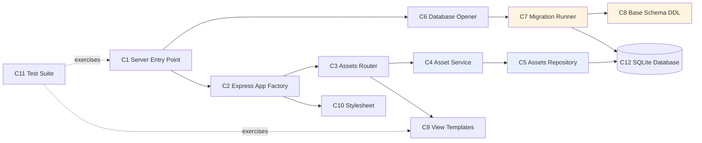

# Component Inventory

Every runtime component of the `assets_management` application, with its
responsibilities, dependencies, and the code that implements it.

The component names in this file are **canonical**: they are the names recorded
in the `analyzed.components` list of the
[Scope of Analysis](reverse-engineering-timestamp.md) block, and the rerun
guard compares them literally.

## Component List

| # | Component | Kind | Location |
|---|---|---|---|
| C1 | Server Entry Point | Entry point | `src/server.js` |
| C2 | Express App Factory | HTTP composition | `src/app.js` |
| C3 | Assets Router | HTTP adapter | `src/routes/assets.js` |
| C4 | Asset Service | Domain service | `src/services/asset-service.js` |
| C5 | Assets Repository | Data access | `src/repositories/assets-repo.js` |
| C6 | Database Opener | Infrastructure | `src/db/index.js` |
| C7 | Migration Runner | Infrastructure | `src/db/migrate.js` |
| C8 | Base Schema DDL | Infrastructure (data) | `src/db/migrations.sql` |
| C9 | View Templates | Presentation | `views/*.ejs` (6 files) |
| C10 | Stylesheet | Presentation | `public/styles.css` |
| C11 | Test Suite | Verification | `tests/*.test.js` + `tests/helpers/seed.js` |
| C12 | SQLite Database | Persistence | `data/assets.sqlite` (runtime artifact) |

---

## C1 — Server Entry Point

**Location**: `src/server.js` (22 lines)

**Responsibilities**
- Resolve the database path: `process.env.DB_PATH`, defaulting to
  `data/assets.sqlite` (`src/server.js:7,11`).
- Resolve the HTTP port: `process.env.PORT`, defaulting to 3000
  (`src/server.js:8`).
- Open the database, build the app, and start listening (`src/server.js:12-16`).
- Log the listen URL.
- Self-execute only when run directly (`require.main === module`,
  `src/server.js:19-21`) so tests can import `main` without side effects.

**Dependencies**: C6 (Database Opener), C2 (Express App Factory), `node:path`.

**Exports**: `main()`.

**Notes**: No clustering, no graceful-shutdown handling, no process manager
configuration, no signal handlers.

---

## C2 — Express App Factory

**Location**: `src/app.js` (28 lines)

**Responsibilities**
- Configure the view engine (`ejs`) and the views directory (`src/app.js:9-10`).
- Install `express.urlencoded({ extended: false })` body parsing
  (`src/app.js:11`).
- Serve `public/` under `/static` (`src/app.js:12`).
- Redirect `/` to `/assets` (`src/app.js:14`).
- Mount the assets router at `/assets` (`src/app.js:15`).
- Own the **error middleware**, which is the single translation point from a
  domain error `code` to an HTTP status (`src/app.js:17-24`).

**Dependencies**: C3 (Assets Router), `express`, `node:path`.

**Exports**: `createApp(db)`.

**Notes**
- The `db` handle is closed over and injected into the router — there is no
  request-scoped context.
- The error handler maps `NOT_FOUND` → 404 and
  `DUPLICATE_ASSET` / `VALIDATION_ERROR` / `INVALID_TRANSITION` → 400.
  `INVALID_STATE` is **not** in the list and falls through to a 500.
- No security middleware, no CORS configuration, no helmet, no compression, no
  session.

---

## C3 — Assets Router

**Location**: `src/routes/assets.js` (94 lines)

**Responsibilities**
- Define the eight HTTP handlers (7 endpoints plus the root redirect in C2).
- Coerce and normalise request input at the boundary: `String(...)`, `.trim()`,
  and whitelisting of `sort` and `dir` (`src/routes/assets.js:11-16,37-44`).
- Delegate all business work to the service layer.
- Translate domain errors into either a re-rendered form (400 on the create
  path, `src/routes/assets.js:50-52`) or `next(err)` for the error middleware.
- Render views or issue 302 redirects.

**Dependencies**: C4 (Asset Service), `express`.

**Exports**: `assetsRouter(db)` — a router factory closing over `db`.

**Notes**
- Every handler uses the same `try { … } catch (err) { next(err) }` shape.
- All successful writes redirect (Post/Redirect/Get).
- The `POST /assets` success redirect target carries no asset id.

---

## C4 — Asset Service

**Location**: `src/services/asset-service.js` (115 lines)

**Responsibilities**
- Own the **state machine**: the `TRANSITIONS` table and `assertTransition`
  (`src/services/asset-service.js:5-10,18-26`).
- Implement the six business operations: `registerAsset`, `assignAsset`,
  `returnAsset`, `markLost`, `getAssetWithAudit`, `listAssets`.
- Emit the audit entry for every registration and every transition.
- Build the human-readable audit descriptions (`ACTION_DESCRIPTIONS`,
  `src/services/asset-service.js:12-16`).
- Construct domain errors through `makeError(message, code)`
  (`src/services/asset-service.js:28-32`).

**Dependencies**: C5 (Assets Repository).

**Exports**: `registerAsset`, `assignAsset`, `returnAsset`, `markLost`,
`getAssetWithAudit`, `listAssets`, `TRANSITIONS`.

**Notes**
- This is where the "always create in `in-stock`" rule lives
  (`src/services/asset-service.js:35-37`).
- The asset write and the audit write are **not** in one transaction
  (`src/services/asset-service.js:52-94`) — a throw between them leaves the
  asset updated with no audit row.
- The service layer is the **only** place transition validation happens; the
  repository's `updateAsset` accepts any `status` value.

---

## C5 — Assets Repository

**Location**: `src/repositories/assets-repo.js` (145 lines)

**Responsibilities**
- Own **all** SQL in the system.
- Asset CRUD: `createAsset`, `getAsset`, `updateAsset`.
- The filtered/sorted list query: `listAssets`.
- Audit access: `recordAudit` (insert only) and `latestAuditFor` (read only).
- Timestamp generation: `nowIso`, delegating to SQLite's `strftime`.
- Input validation: `validateCreate`.
- Hold the two vocabulary constants `ALLOWED_CATEGORIES` and `ALLOWED_STATUSES`.

**Dependencies**: the `db` handle (passed in), `node:crypto` (`randomUUID`).

**Exports**: `listAssets`, `getAsset`, `createAsset`, `updateAsset`,
`recordAudit`, `latestAuditFor`, `nowIso`, `ALLOWED_CATEGORIES`,
`ALLOWED_STATUSES`, `validateCreate`.

**Notes**
- Every query is a prepared statement with bound parameters. Dynamic SQL is
  limited to a fixed-fragment `WHERE` clause and a whitelisted sort column.
- `updateAsset` writes every column of a merged row and performs **no**
  transition validation and **no** audit write.
- Duplicate detection is a post-hoc string match on
  `'UNIQUE constraint failed'` (`src/repositories/assets-repo.js:70`).
- `latestAuditFor` uses `ORDER BY id DESC LIMIT 1` — the only audit read path
  in the codebase.

---

## C6 — Database Opener

**Location**: `src/db/index.js` (21 lines)

**Responsibilities**
- Create the parent directory when the target is not `:memory:`
  (`src/db/index.js:10-13`).
- Open the `better-sqlite3` handle (`src/db/index.js:14`).
- Set the pragmas: `journal_mode = WAL` and `foreign_keys = ON`
  (`src/db/index.js:15-16`).
- Apply pending migrations before returning the handle (`src/db/index.js:17`).

**Dependencies**: C7 (Migration Runner), `better-sqlite3`, `node:fs`,
`node:path`.

**Exports**: `openDatabase(filename)`.

**Notes**
- **`busy_timeout` is never set.** The effective value comes from the
  `better-sqlite3` default (5000 ms), not from an application decision.
- `foreign_keys = ON` is set here, but `applyMigrations` can be called against
  a raw handle where it is off — which matters for any table rebuild.

---

## C7 — Migration Runner

**Location**: `src/db/migrate.js` (73 lines)

**Responsibilities**
- Read `migrations.sql` once at module load (`src/db/migrate.js:6`).
- Maintain the `schema_migrations` ledger table
  (`src/db/migrate.js:43-51`).
- Apply each unapplied migration exactly once, in version order, each inside
  its own transaction that also records the version
  (`src/db/migrate.js:58-68`).
- Provide `addColumnIfMissing`, the JavaScript workaround for SQLite's lack of
  `ALTER TABLE … ADD COLUMN IF NOT EXISTS` (`src/db/migrate.js:35-41`).

**Dependencies**: `node:fs`, `node:path`, and C8 (Base Schema DDL) for the
v1 body.

**Exports**: `applyMigrations(db)`, `MIGRATIONS`, `MIGRATIONS_SQL`.

**Notes**
- The current ledger holds two migrations: v1 `base-schema`, v2
  `lifecycle-timestamps` (`src/db/migrate.js:13-33`).
- There is no `down`/rollback path and no pragma-management hook — a
  constraint that bears directly on the rebuild ordering described in
  [architecture.md](architecture.md) § The migration ordering constraint.

---

## C8 — Base Schema DDL

**Location**: `src/db/migrations.sql` (41 lines)

**Responsibilities**
- Define the `assets` table with its two `CHECK` constraints (category and
  status), the `UNIQUE (category, serial_or_key)` constraint, the lifecycle
  timestamp columns, and the timestamp defaults (`src/db/migrations.sql:10-27`).
- Define the `audit_log` table with its foreign key and `ON DELETE CASCADE`
  (`src/db/migrations.sql:29-36`).
- Create the three indexes: `idx_audit_asset_recent`, `idx_assets_status`,
  `idx_assets_category` (`src/db/migrations.sql:38-40`).

**Dependencies**: none — it is data, read by C7.

**Notes**
- Applied as **migration v1 only** (`src/db/migrate.js:17-19`). A later
  migration must re-issue index DDL itself rather than relying on this file.
- Written with `IF NOT EXISTS` throughout, so re-applying it is safe.
- `ALTER TABLE … DROP CONSTRAINT` is not supported by SQLite, so any change to
  the status vocabulary or the cascade requires a full table rebuild.

---

## C9 — View Templates

**Location**: `views/` (6 files, EJS)

**Responsibilities**
- `_header.ejs` — shared page chrome, stylesheet link, top bar, "New asset"
  nav button.
- `_footer.ejs` — closes `<main>` and the document.
- `_layout.ejs` — **dead code**; nothing includes it, and it duplicates the
  header markup.
- `list.ejs` — the filter form and the 5-column results table, with one
  empty state.
- `new.ejs` — the registration form and the error block.
- `detail.ejs` — the record, one audit entry, and the per-status action forms.
- `error.ejs` — the error page.

**Dependencies**: C2/C3 supply the data; the EJS engine resolves the
templates.

**Notes**
- Every template includes `_header` and `_footer` directly — there is no
  layout mechanism in use.
- All user-supplied values are escaped with `<%= %>`. The only unescaped
  output is `include()`.
- Interactive elements carry `data-testid` attributes as a repo-wide
  convention for UI automation.
- `detail.ejs:26-49` is one of the six copies of the status vocabulary: the
  per-status action forms are hard-coded per state.

---

## C10 — Stylesheet

**Location**: `public/styles.css` (48 lines)

**Responsibilities**
- Define the CSS custom-property palette in `:root` (lines 1-10).
- Style the top bar, buttons, forms, tables, the details grid, the audit
  section, and the action row.
- Provide the `.status-*` colour tokens for the four lifecycle states
  (lines 27-30).

**Dependencies**: none.

**Notes**
- The `.status-*` classes are one of the six copies of the status vocabulary;
  a new status value has no colour until a rule is added here.
- No build step, no preprocessor, no CSS framework.

---

## C11 — Test Suite

**Location**: `tests/` (5 spec files + `tests/helpers/seed.js`, 827 lines)

**Responsibilities**
- `db.test.js` (7 tests) — schema, the unique constraint, audit timestamps,
  the lifecycle columns, the default state, a legacy-schema migration, and the
  migration ledger.
- `assets-repo.test.js` (15 tests) — repository CRUD, validation, filtering,
  sorting, audit insert, `latestAuditFor`, `updateAsset` timestamp
  persistence, and a write-burst consistency check.
- `asset-service.test.js` (18 tests) — every legal and illegal state-machine
  edge, and the lifecycle timestamps.
- `routes.test.js` (14 tests) — HTTP integration via `supertest`.
- `views.test.js` (12 tests) — rendered-HTML assertions.
- `helpers/seed.js` — `seedTwoAssets`, `seedAsset`, `resetState`,
  `latestAssetId`.

**Dependencies**: C1–C9 (all of them, in the sense that the suite exercises
every layer).

**Notes**
- Every spec uses a fresh `:memory:` database in `beforeEach`; **no test
  touches `data/`**.
- The one exception is the legacy-migration test at `tests/db.test.js:59-93`,
  which builds a legacy schema on a raw handle to simulate a database written
  by an earlier release. It creates only an `assets` table and **no audit rows**
  — so it would not have detected the cascade data loss.
- No test asserts an audit row **count**, an audit **ordering** across many
  transitions, or the cascade behaviour.

---

## C12 — SQLite Database

**Location**: `data/assets.sqlite` (plus `-wal` and `-shm` sidecar files),
gitignored, 4096 + 292552 + 32768 bytes at scan time.

**Responsibilities**
- Persist the two tables and the three indexes, plus the `schema_migrations`
  ledger.

**Dependencies**: C5 reads and writes it; C6 opens it; C7 migrates it.

**Notes**
- **Read-only for any analysis work.** It is the only place a real migration
  would meet non-empty data, and it must never be touched by a probe.
- The WAL mode means `-wal` and `-shm` files exist alongside the main
  database.
- The base migration's `IF NOT EXISTS` idiom makes re-applying it safe, but a
  planned rebuild migration is **not** inherently idempotent and must be
  written to be re-runnable.

---

## Component Dependency Map

Dependencies are strictly downward: C3 → C4 → C5 → C12, with C6 → C7 → C8 as
a parallel infrastructure spine. There are no cycles.

---

## Absent Components

These are the capabilities the Asset Tracker MVP adds. They have **no**
implementation anywhere in the codebase — verified by exhaustive grep across
`src/`, `tests/`, and `views/` — so they are greenfield components, not
refactors of existing ones.

| Absent capability | Evidence of absence |
|---|---|
| Counting / metrics component | No `COUNT` query; no aggregation function anywhere |
| Reconciliation dashboard | No `dashboard` identifier anywhere |
| Assignee directory | No directory table; `assigned_to` is a bare `TEXT` column (`src/db/migrations.sql:18`) |
| CSV export | No `csv` / `export` identifier anywhere |
| Actor concept | No `actor` / `operator` / `acting` identifier anywhere; `audit_log` has no actor column (`src/db/migrations.sql:29-36`) |
| Shared filter-builder / counting definition | No reusable filter construction; each query builds its own `WHERE` inline |
| Full audit-history retrieval | Only `ORDER BY id DESC LIMIT 1` exists |
| Linting configuration | No ESLint/Prettier/Biome config, no lint script |
| CI/CD pipeline | No `.github/`, no pipeline file, no container definition |

## Cross-References

- API contracts for every component above:
  [api-documentation.md](api-documentation.md)
- Interaction diagrams and the migration-ordering constraint:
  [architecture.md](architecture.md)
- Module organisation and the code patterns used here:
  [code-structure.md](code-structure.md)
- Test, linting, CI, and technical-debt detail:
  [code-quality-assessment.md](code-quality-assessment.md)
