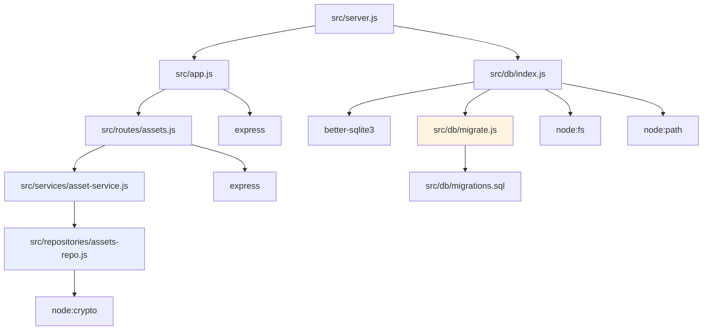
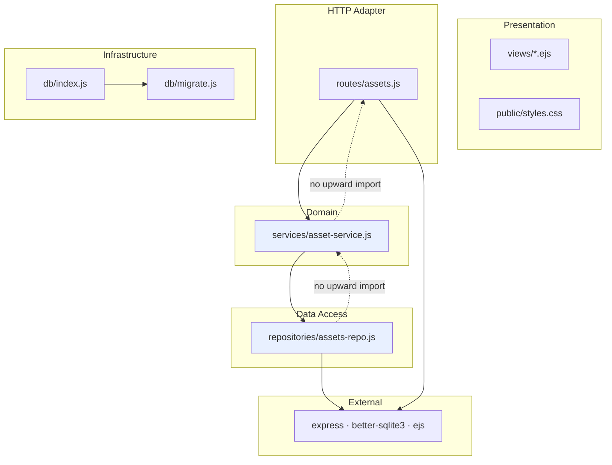

# Dependencies

## Overview

`assets_management` is a **single-package repository** with **three runtime
dependencies** and **three development dependencies**. There is no monorepo,
no `workspaces` declaration, and no `packages/` directory — so there are no
cross-package dependencies and no internal package graph.

## External Dependencies

### Runtime (`package.json:19-23`)

| Package | Declared range | Resolved | Purpose | Used at |
|---|---|---|---|---|
| `express` | `^4.21.0` | 4.x | HTTP server, routing, body parsing, static serving, error middleware | `src/app.js:4`, `src/routes/assets.js:3` |
| `better-sqlite3` | `^11.3.0` | 11.x | Synchronous SQLite driver | `src/db/index.js:5`, `tests/db.test.js:3` |
| `ejs` | `^3.1.10` | 3.x | Server-side template rendering for `views/*.ejs` | Via the Express view engine, `src/app.js:9-10` |

### Development (`package.json:24-28`)

| Package | Declared range | Resolved | Purpose | Used at |
|---|---|---|---|---|
| `vitest` | `^2.1.2` | 2.1.9 | Test runner | `vitest.config.js:3`, all spec files (via `globals: true`) |
| `@vitest/coverage-v8` | `^2.1.9` | 2.1.9 | V8 coverage provider | `vitest.config.js:16-22` |
| `supertest` | `^7.0.0` | 7.x | In-process HTTP testing | `tests/routes.test.js`, `tests/views.test.js` |

### Node.js built-ins

| Module | Purpose | Used at |
|---|---|---|
| `node:crypto` | `randomUUID()` — asset id generation | `src/repositories/assets-repo.js:3` |
| `node:path` | Path joining | `src/app.js:3`, `src/db/index.js:4`, `src/db/migrate.js:4`, `src/server.js:3` |
| `node:fs` | `mkdirSync`, `existsSync`, `readFileSync` | `src/db/index.js:3`, `src/db/migrate.js:3` |

### Transitive dependencies

204 top-level entries are installed in `node_modules/`. The lockfile is 134 KB.
The transitive closure was **not** analysed in depth — it is recorded as a
shallow area in the [Scope of Analysis](reverse-engineering-timestamp.md)
block. The only transitive dependency with architectural significance is
`better-sqlite3`'s native binding to the system SQLite, which pins the SQLite
version behaviour described in
[technology-stack.md](technology-stack.md) § Verified platform constraints.

## Internal Dependency Graph

Every `require` edge in the application source. This is the complete
internal dependency set — there are no other intra-repository imports.

### Edge table

| From | To | Kind | Line |
|---|---|---|---|
| `src/server.js` | `src/db/index.js` | internal | `src/server.js:4` |
| `src/server.js` | `src/app.js` | internal | `src/server.js:5` |
| `src/app.js` | `src/routes/assets.js` | internal | `src/app.js:5` |
| `src/app.js` | `express` | external | `src/app.js:4` |
| `src/app.js` | `node:path` | builtin | `src/app.js:3` |
| `src/routes/assets.js` | `src/services/asset-service.js` | internal | `src/routes/assets.js:4` |
| `src/routes/assets.js` | `express` | external | `src/routes/assets.js:3` |
| `src/services/asset-service.js` | `src/repositories/assets-repo.js` | internal | `src/services/asset-service.js:3` |
| `src/repositories/assets-repo.js` | `node:crypto` | builtin | `src/repositories/assets-repo.js:3` |
| `src/db/index.js` | `better-sqlite3` | external | `src/db/index.js:5` |
| `src/db/index.js` | `src/db/migrate.js` | internal | `src/db/index.js:6` |
| `src/db/index.js` | `node:fs` | builtin | `src/db/index.js:3` |
| `src/db/index.js` | `node:path` | builtin | `src/db/index.js:4` |
| `src/db/migrate.js` | `src/db/migrations.sql` | internal (data file, read at module load) | `src/db/migrate.js:6` |

### Dependency properties

| Property | Finding |
|---|---|
| Cycles | **None.** The graph is a strict tree. |
| Direction | Strictly downward: `routes → services → repositories → db`. The repository never imports the service; the service never imports the router. |
| Layering violations | **None.** No SQL above the repository layer; no HTTP concerns below the router; no business rules in the repository. |
| `views/` reachability | **Not via `require`.** The EJS engine resolves the templates from the `views` directory configured at `src/app.js:10`. |
| `public/` reachability | **Not via `require`.** Served as static files by `express.static` (`src/app.js:12`). |
| Cycles through the framework | None. The router factory closes over `db` (`src/routes/assets.js:6`), so the handle flows down by closure rather than by an import cycle. |
| Test-suite edges | The five spec files import the modules under test (`../src/db`, `../src/repositories/assets-repo`, `../src/services/asset-service`, `../src/app`, `../src/db/migrate`) and the local helper `./helpers/seed`. `tests/helpers/seed.js` imports the **service** (`../../src/services/asset-service`) and seeds through it rather than writing SQL directly. |

### The `db` handle as an implicit dependency

The `better-sqlite3` handle is not injected through a module-level import; it
is **passed explicitly** as the first argument to every repository and service
function, and closed over by the router factory. This is why the repository
functions have the signature `(db, …)` and why `openDatabase` is the only
place a handle is created. It also means a test can hand the same code a
`:memory:` handle — which is exactly what the whole suite does.

## Dependency Direction Diagram (Layered View)

## External Service Dependencies

**None.** The application makes no outbound network requests of any kind.
Verified: no `fetch`, no `axios`, no `http`/`https` client import, no
`node:net`, no cloud SDK, no webhook or messaging client anywhere in `src/` or
`tests/`. The application holds no API keys, no tokens, and no credentials, and
requires no secret store.

The MCP server registrations in `.mcp.json` (context7, aws-mcp, aws-pricing,
aws-iac, aws-serverless) are development-harness tooling, not application
dependencies, and are not loaded by any application code.

## Dependency Gaps Relevant to the MVP

These are dependencies the Asset Tracker MVP will need that **do not exist
today**. They are recorded here so the dependency inventory is complete for
planning purposes; the full analysis is in
[code-quality-assessment.md](code-quality-assessment.md).

| Needed capability | Current dependency situation |
|---|---|
| Case-insensitive uniqueness | No functional index today. SQLite's functional-index support is **verified available** — no new package required. |
| Concurrency-safe uniqueness | `better-sqlite3` supports `db.transaction(fn).immediate(...)` and `db.pragma('busy_timeout = …')` — **no new package required**. `SQLITE_BUSY` handling must be written by hand. |
| Actor identity | No mechanism exists. A session, header, or server-side-context mechanism would be required; **no package exists today** to supply one, and the choice is an open architectural decision. |
| CSV export | No CSV library. Node's built-in `node:csv` does not exist, so a writer is hand-written or a dependency is added — and formula-injection protection must be implemented either way. |
| Linting | No linter installed. |
| CI | No pipeline, no CI service configuration, no CI-specific dependencies. |

## Cross-References

- Versions, runtime, and the build/tooling picture:
  [technology-stack.md](technology-stack.md)
- Component responsibilities: [component-inventory.md](component-inventory.md)
- Module organisation: [code-structure.md](code-structure.md)
- The migration-ordering constraint that bounds the `db` layer:
  [architecture.md](architecture.md)
