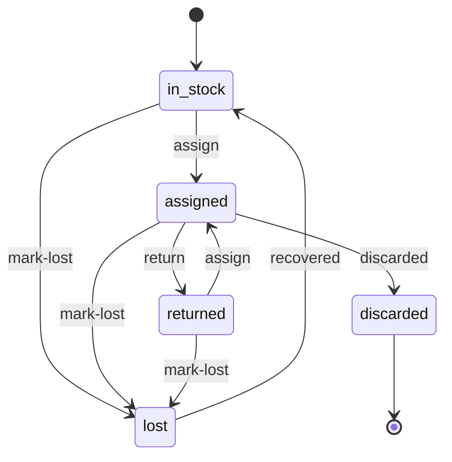
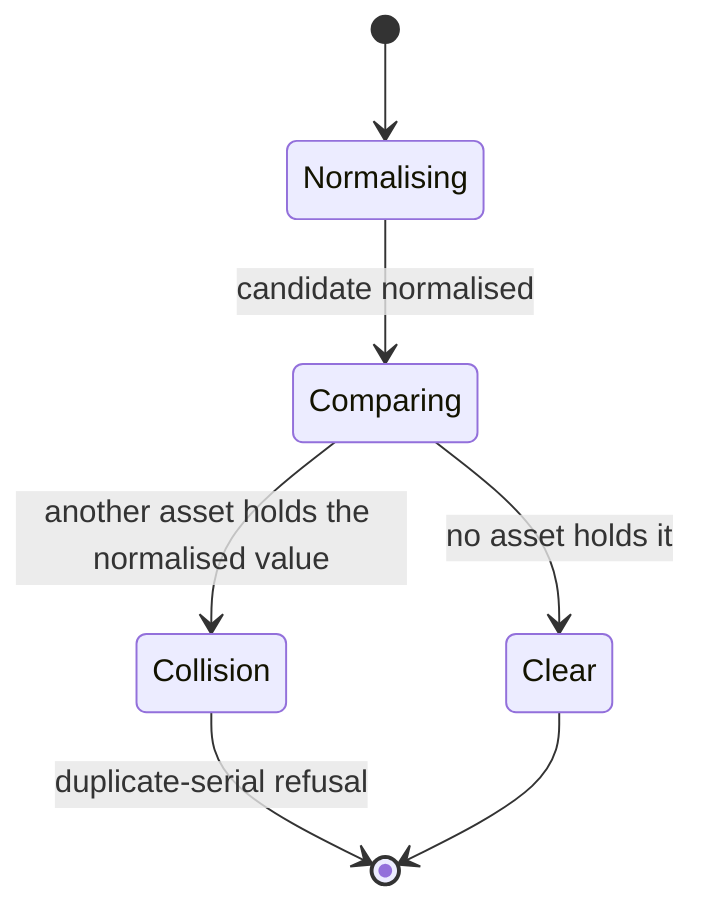
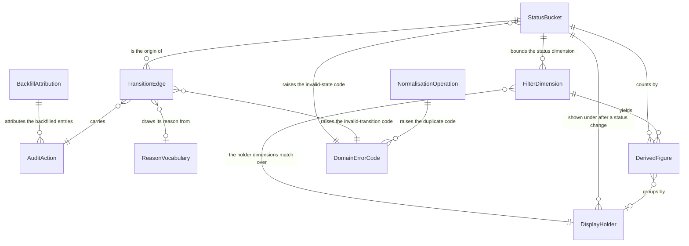

# Functional Specification — Domain Vocabulary and Error Contract (`u2-domain-vocabulary`)

**Stage**: functional-design (construction)
**Intent**: 261106-asset-tracker-mvp
**Space**: default
**Scope**: feature
**Unit**: `u2-domain-vocabulary` — Domain Vocabulary and Error Contract
**Unit kind**: `library`

This file specifies the unit's workflows and its state machines. It is the
**source of truth** for both. The entity model and the business rules are
specified in `entities.md` and `rules.md`; the two views derived from them —
the entity-relationship diagram and the rules summary — appear at the end of
this file, and are views rather than sources.

**What this unit does.** It owns the release's closed vocabularies and the
rules that derive a value from another. It holds no asset, no audit entry, no
holder record and no database handle. The **vocabulary** it owns holds no HTTP
concept at all; the unit's **translation component** holds the one mapping
that turns a domain code into the boundary's reading of it, and that
component is the only thing in the unit that knows a status. It depends on
nothing but the platform's own runtime.

**What this unit does not do.** It does not perform a transition, write an
audit entry, read a row, aggregate a count, or turn a refusal into a response.
Those belong to the units that own them. This unit answers the questions
those units ask.

---

## The Unit's Shape

Two components, and the split between them is the direction of the dependency.

- **`DomainVocabulary`** holds the values: the five status buckets and their
  display labels, the eight released transition edges, the two reason sets, the
  seven audit actions, the eight error codes with their retryable flags, the
  serial-or-key normalisation operation, the display-holder derivation, the
  five form filter dimensions and the two holder dimensions, the eight derived
  figures, and the reserved backfill attribution value. It holds **no** HTTP
  concept: no status, and no mapping that produces one.
- **`ErrorTranslation`** is the single translation point from a domain code to
  the boundary's reading of it. It reads the code set and each code's
  retryable flag from the vocabulary, and it holds the complete
  code-to-status mapping as its own content. It is the only component in the
  release that knows a status.

The domain components raise refusals carrying a code; they never ask for a
status. That direction is what keeps this unit a leaf, and the leaf property
holds literally rather than by argument: the vocabulary has no status in it
to reach, so no domain component can read one even by accident. The status
column lives with the one component whose entire job is to produce it.

### The code-to-status mapping

The mapping is `ErrorTranslation`'s own content. It is stated once, in full,
in `entities.md` under `## The Code-to-Status Mapping`:

| Code | Boundary status | Retryable |
|---|---|---|
| `VALIDATION_ERROR` | 400 | No |
| `DUPLICATE_ASSET` | 409 | No |
| `NOT_FOUND` | 404 | No |
| `INVALID_TRANSITION` | 400 | No |
| `INVALID_STATE` | 400 | No |
| `ASSET_DELETE_REFUSED` | 405 | No |
| `BUSY_RETRYABLE` | 503 | **Yes** |
| `INTERNAL` | 500 | No |

---

## Workflow 1 — Deciding whether a transition is legal

This is the unit's most-used workflow. Four units call it: the write path,
which enforces it; the presentation unit, which renders the per-status action
controls from it; the foundation unit, which reads the status set to build the
schema's constraint; and the reporting unit, which reads the status set to
build its bucket aggregation.

**Trigger.** A component needs to know whether an asset may move from status A
to status B.

**Steps.**

1. The caller supplies the asset's current status and the requested
   destination status.
2. The unit looks up the pair in the released transition table.
3. IF the pair is one of the eight released edges, THEN the unit reports that
   the transition is legal, and reports which audit action the edge carries
   and whether the edge requires a reason. The caller then performs the
   transition, appends that audit action, and requires a reason only when
   the edge says a reason is required.
4. ELSE the unit reports that the transition is illegal, and identifies it as
   either an edge that is not released at all, or an edge released from a
   different origin status.
5. Only when step 4 reported the edge illegal, the caller refuses the
   transition with the invalid-transition error code, appends no audit entry,
   and leaves the asset unchanged. A legal edge from step 3 is never refused
   by this step.

**Notes.**

- Step 4's two cases are distinguished because they are different situations:
  a deferred edge is refused permanently in this release, while a released
  edge attempted from the wrong origin is a mistake in the caller. The caller
  distinguishes them by the status it supplied, not by an extra query.
- The unit reports the edge's audit action and reason requirement as part of
  the same answer, so that a caller cannot learn that an edge is legal and
  then have to ask a second question to learn what it entails.

**Governing rules.** BR2.1, BR2.2, BR2.3, BR4.2, BR4.3, BR3.4.

---

## Workflow 2 — Deciding whether a serial or key collides

**Trigger.** A component needs to know whether a serial or licence key is
already taken in a category. Three callers ask: the registration path, the
edit path, and the inline duplicate warning shown before submission.

**Steps.**

1. The caller supplies the candidate serial or key, the category, and — where
   one applies — the asset being edited, to exclude from the comparison.
2. The unit puts the candidate through the normalisation operation: trim
   leading and trailing whitespace, then fold case. The fold lowercases the
   ASCII letters A to Z and leaves every other character, including a
   non-ASCII letter, unchanged. That result is defined for every character.
3. The unit compares the normalised candidate against every asset in the
   supplied category, excluding the asset the caller excluded, comparing on the
   same normalised form.
4. IF another asset in that category holds the same normalised value, THEN the
   unit reports a collision.
5. ELSE the unit reports no collision.
6. The caller that performs the authoritative check refuses the write with the
   duplicate-serial error code — the same code whether the collision was
   detected here or by the database's unique index.

**Notes.**

- Step 3 compares on the normalised form but the comparison never changes what
  is stored: the serial or key is stored and displayed as the user supplied
  it.
- Step 2's fold lowercases ASCII letters and leaves every other character
  unchanged, and both tiers implement that same result. SQLite's `LOWER()`
  already leaves a non-ASCII letter unchanged, so the application tier does
  the same rather than calling a Unicode-aware fold. A non-ASCII letter is
  not a permitted disagreement: both tiers leave it unchanged, and the
  agreement test fails if they return different collision answers on it.
- Step 6's clause is the reason there is one duplicate-serial code rather than
  two. A caller cannot tell which tier caught the collision, and does not need
  to.
- The three callers differ in their **transaction discipline**, not in the
  comparison. The registration path and the edit path run the authoritative
  check inside an immediate transaction with a non-zero busy timeout, so a
  concurrent writer waits for the lock; the inline warning runs a deferred
  read and takes no write lock, so it cannot block a colleague and cannot
  raise a busy condition. The comparison itself is the same one operation in
  both cases.

**Governing rules.** BR5.1, BR5.2, BR5.3, BR5.4, BR5.5, BR6.1, BR6.3.

---

## Workflow 3 — Deriving an asset's display holder

**Trigger.** A component needs the holder an asset is shown under.

**Steps.**

1. The caller supplies the asset's current holder and its preserved previous
   holder.
2. IF the current holder exists, THEN the display holder is the current
   holder.
3. ELSE IF the preserved previous holder exists, THEN the display holder is
   the preserved previous holder.
4. ELSE the display holder is the reserved `Unassigned` designation, and the
   asset is marked as never held.

**Notes.**

- The derivation is performed here, once, and every consumer calls it. No
  consumer applies the fallback order for itself, which is what makes the
  directory's rows agree with the asset list's rows.
- The two holder fields never echo one another. The derivation consults the
  previous holder only when the current holder is absent, so an asset whose
  two fields hold the same name is still shown under one holder rather than
  two.
- The reserved designation is a distinct value, not a holder name, and it
  applies only to an asset that has never been held. An asset whose holder
  name happens to read `Unassigned` is distinguishable from one that has never
  been held.
- The reserved designation is also not a holder **for counting**: a count of
  display holders excludes it, and the directory renders one row per display
  holder plus the reserved row, so the rendered row count is one greater than
  the holder count.

**Governing rules.** BR7.1, BR7.2, BR7.3, BR7.4.

---

## Workflow 4 — Building a filter and deriving the counts from it

**Trigger.** One of the four count-consuming surfaces — the dashboard, the
holder directory, the asset list, or the CSV export — needs to select or count
assets.

**Steps.**

1. The surface supplies the filter's state: a value for each of the five
   dimensions, plus the holder dimension where the request carries one.
2. The unit checks each supplied value against its dimension's accepted set.
3. IF a value is outside its dimension's accepted set, THEN that dimension is
   omitted from the filter, and the remaining dimensions still apply.
4. The unit hands the surviving dimensions to the counting component, which
   evaluates them and returns the figures.
5. The figures this unit's definition produces are the five bucket counts, the
   active inventory count, the total record count, and the available-to-assign
   count — each derived from the one filter definition that was applied. The
   counting component's own return shape is wider than this list: it also
   carries the asset list's shown and matching counts, which are the
   reporting unit's figures and depend on how many rows the list renders.
6. The surface reads the figures it renders from that one source. It computes
   no count of its own, and it takes no figure from another surface.

**Notes.**

- Step 3 is the resolution of the "dropped, not treated as a match" rule. One
  bad value narrows nothing on its own dimension and does not disable the
  others; it never widens the result either, which is what a whole-filter
  discard would do.
- Step 5's figures hold their relations: the five bucket counts sum to the
  total record count, the total record count includes discarded assets, and
  the active inventory does not. The difference between the two is exactly
  the discarded count.
- Step 5 is deliberately not a restatement of the counting component's
  return shape. This unit owns the **definition** of each figure and the
  relations between the figures it defines; the reporting unit owns the
  **return shape**, which additionally carries the shown and matching counts.
  Naming only this unit's figures here keeps the boundary visible: a
  developer building the counting component against the contract's shape
  returns six fields, and a developer building against this unit's definition
  names eight. The two are the same definition evaluated at two levels.
- **The asset holder dimension matches over the display holder, not the raw
  current-holder column.** It is a free-text containment match over the
  asset's display holder, set by a directory row link, and it selects assets.
  The directory's holder search is not that dimension and is not part of the
  asset filter. It filters the holder rows the directory lists, by the same
  display-holder name, as contract 10 states.
- The unit holds the **definition** of the filter and of each figure; the
  **aggregation** that evaluates them belongs to the reporting unit, because
  the split follows the data rather than the layer. That is what lets this
  unit stay a leaf and still give the four surfaces one definition by
  construction rather than by review.

**Governing rules.** BR8.1, BR8.2, BR8.3, BR8.4, BR8.5, BR9.1, BR9.2, BR9.3, BR9.4,
BR9.5, BR9.6.

---

## Workflow 5 — Validating a recorded reason against the operation

**Trigger.** A component receives a reason with a loss, a recovery or a
retirement.

**Steps.**

1. The caller supplies the reason and the operation it belongs to.
2. The unit checks that a reason is present.
3. The unit checks that the reason is a member of the operation's acceptable
   set: for a loss or a recovery, the general loss-reason set; for a
   retirement, the union of the general loss-reason set and the
   retirement-reason set.
4. IF the reason is absent or outside the acceptable set, THEN the unit
   reports the refusal, and the caller refuses the operation with the
   validation error code, makes no field change, and appends no audit entry.
5. ELSE the unit reports the reason as accepted, together with the set it
   belongs to, so that the caller can label it.

**Notes.**

- Step 5's second half exists because the two sets are separately named. A
  surface that offers a reason can therefore say which kind of reason it is
  offering, rather than presenting one undifferentiated list.
- The retirement path's acceptable set is the union of both sets. The two sets
  being separately named does not make them exclusive at the point of use: a
  retirement accepts either kind of reason, and a loss or a recovery accepts
  only the general kind.

**Governing rules.** BR3.1, BR3.2, BR3.3, BR3.4.

---

## Workflow 6 — Translating a refusal for the boundary

**Trigger.** A domain refusal carrying a code reaches the boundary.

**Steps.**

1. The boundary reads the code off the refusal's machine-readable property.
2. IF the code is in the vocabulary, THEN the translation component looks the
   code up in **its own** code-to-status mapping and returns the boundary's
   status for it, together with whether it may be retried.
3. ELSE IF the failure carries no domain code at all, THEN it is surfaced as
   the internal fallback.
4. ELSE — the failure carries a code that is present but is not one of the
   eight — it is surfaced as the internal fallback, exactly as a failure
   carrying no code is.
5. IF the code is the busy code, THEN the refusal is transient and the caller
   is told to try again.

**Notes.**

- Step 1 reads the code, never the message text. The message is human-facing
  prose and is not part of the contract; the code's meaning is the code.
- Step 3's rule is deliberate: a failure the release does not understand is
  not translated into a domain code, because that would invent a meaning the
  release has not defined and would tell a caller to retry something it
  cannot diagnose.
- **Step 4 closes the same hole for a code that is present but unrecognised.**
  The two cases are the same case: a code outside the vocabulary is not a
  domain code, whether it is absent or merely unrecognised. Without step 4 a
  failure carrying an unknown code would fall through steps 2 and 3 and the
  translation would have no stated outcome for it. The internal fallback is
  the right answer for it for the same reason it is the right answer for the
  no-code case: the release cannot tell the caller what to do with a code it
  does not define, so it does not invent one.
- Every code in the vocabulary is mapped, so no code reaches the client as an
  unmapped internal error. The invalid-state code in particular is mapped,
  which closes the gap in the existing application where an asset in an
  unknown status is refused but the refusal is unhandled and surfaces as a
  server fault.
- The status column is the translation component's own content. It is not an
  attribute of the error-code vocabulary. The vocabulary holds the code set
  and the retryable flag. There is one translation component, so a code's
  status cannot differ between two boundaries.

**Governing rules.** BR6.1, BR6.2, BR6.3, BR6.4, BR6.5, BR6.6.

---

## State Machine 1 — The asset status lifecycle

The unit owns the state machine's **table**. It does not perform the
transition, and it does not own the asset's state — the write path does. What
the unit owns is the definition of which edges exist, which is what makes the
write path's enforcement and the presentation unit's action controls agree.

**States.** Five: `in-stock`, `assigned`, `returned`, `lost`, `discarded`.

**Released edges — exactly eight.**

| # | From | To | Audit action | Reason required | Acceptable reason set |
|---|---|---|---|---|---|
| 1 | `in-stock` | `assigned` | `assign` | No | — |
| 2 | `in-stock` | `lost` | `mark-lost` | Yes | Loss reasons |
| 3 | `assigned` | `returned` | `return` | No | — |
| 4 | `assigned` | `lost` | `mark-lost` | Yes | Loss reasons |
| 5 | `assigned` | `discarded` | `discarded` | Yes | Loss reasons and retirement reasons |
| 6 | `returned` | `assigned` | `assign` | No | — |
| 7 | `returned` | `lost` | `mark-lost` | Yes | Loss reasons |
| 8 | `lost` | `in-stock` | `recovered` | Yes | Loss reasons |

**Deferred edges — refused in this release.**

| From | To | Disposition |
|---|---|---|
| `in-stock` | `discarded` | Not in the released table. Refused with the invalid-transition code. |
| `returned` | `discarded` | Not in the released table. Refused with the invalid-transition code. |

**The transition diagram.**

**Reading the diagram against the table.** Each of the eight released edges
appears exactly once, and each arrow's label is the edge's audit action. The
two deferred edges appear as **no arrow at all** — their absence is the
diagram's statement of the deferral, and the table above records them
explicitly so that the absence is not read as an oversight.

**The recovery edge is distinct.** `lost → in-stock` carries the `recovered`
action, not `assign` and not `return`. The recovery's reason is drawn from the
general loss-reason set, and its audit entry names the recovery and the prior
holder.

**The three loss edges share one action.** `in-stock → lost`, `assigned → lost`
and `returned → lost` each append exactly one `mark-lost` entry, and no action
is introduced for an origin. There is no seventh edge-specific action and no
origin-specific variant.

**The discard edge resolves the assignment inline.** The departing current
holder is recorded into the preserved previous holder, then the current holder
is cleared, so the holder at discard time stays visible; and the audit entry
records the discard, the prior holder, and the fact that the assignment was
resolved by the discard. A discarded asset remains in the `discarded` bucket
and in the total record count, is excluded from the active inventory, and
remains accessible at its detail URL with its history intact.

**Governing rules.** BR2.1, BR2.2, BR2.3, BR4.1, BR4.2, BR4.3, BR3.1–BR3.4,
BR9.1, BR9.2, BR7.1–BR7.4.

---

## State Machine 2 — The uniqueness check's two tiers

The unit owns the comparison. The two **transaction disciplines** belong to the
component that performs the check, and they differ; the comparison does not.
This state machine records the two tiers because the difference is what the
retryable busy condition depends on.

**The comparison state machine** — one path, one outcome, and the outcome is
one of two. The machine is deliberately trivial: a second definition of
"does this collide" is exactly what lets two definitions disagree, so there is
only one.

**The two disciplines, stated as a table.**

| Tier | Callers | Transaction | May raise the busy code | May block another writer |
|---|---|---|---|---|
| Advisory | The inline duplicate warning | Deferred read | No | No |
| Authoritative | The registration path, the edit path | Immediate, with a non-zero busy timeout | Yes | Yes, until the write completes |

**The busy path.** IF the authoritative check cannot acquire the lock within
the timeout THEN the refusal carries the busy code, and the busy code is the
only one the caller may retry. The advisory tier never raises it, because a
person who is still typing a serial is not looking at a busy database, and a
warning that blocks other writers would be a cost with no benefit.

**Governing rules.** BR5.1, BR5.2, BR5.4, BR5.5, BR6.1, BR6.3, BR6.4.

---

## Derived View — Entity Relationships

This diagram is derived from `entities.md` and is a view, not a source.

**What the diagram shows.** The five status buckets are the hub: they bound
the transition edges, they bound the status filter dimension, they are counted
by the derived figures, and they raise the invalid-state code when an asset's
stored status falls outside them. The reason vocabulary hangs off the edges
that require one. The normalisation operation hangs off the duplicate code,
because it is the operation whose failure is that code. The holder dimensions
match over the derived display holder rather than over a stored column, which
is why the display holder is drawn as a parent of the dimensions. The
backfill attribution hangs off the audit actions, because the rows it stamps
are audit rows whose actions come from that vocabulary.

**What the diagram cannot show, and the table carries.** The two reason sets
are disjoint but a retirement draws from both, so the edge-to-reason
relationship is many-to-one in one direction and one-to-many in the other
depending on which edge is drawn. The reason vocabulary's table in
`entities.md` carries the acceptable-for attribute that resolves it. The
code-to-status mapping is not an attribute of the error code. It is the
translation component's content, stated in the code-to-status section, and
the vocabulary carries no status.

---

## Derived View — Rules Summary

This table is derived from `rules.md` and is a view, not a source.

| Group | Rules | Subject |
|---|---|---|
| BR1 | BR1.1, BR1.2, BR1.3 | The five status buckets and their display labels |
| BR2 | BR2.1, BR2.2, BR2.3 | The eight released transition edges |
| BR3 | BR3.1, BR3.2, BR3.3, BR3.4 | The two reason sets and when a reason is required |
| BR4 | BR4.1, BR4.2, BR4.3, BR4.4 | The seven audit actions and the description's content |
| BR5 | BR5.1, BR5.2, BR5.3, BR5.4, BR5.5 | The serial-or-key normalisation and the collision |
| BR6 | BR6.1, BR6.2, BR6.3, BR6.4, BR6.5, BR6.6 | The eight error codes, and the translation that maps them |
| BR7 | BR7.1, BR7.2, BR7.3, BR7.4 | The display-holder derivation and what counts as a holder |
| BR8 | BR8.1, BR8.2, BR8.3, BR8.4, BR8.5 | The asset filter, and the directory's separate holder-row search |
| BR9 | BR9.1, BR9.2, BR9.3, BR9.4, BR9.5, BR9.6 | The eight derived figures and their relations |
| BR10 | BR10.1, BR10.2 | The single source and its two recorded literal copies |
| BR11 | BR11.1, BR11.2, BR11.3 | The backfill's reserved actor value |

---

## What This Specification Does Not Decide

- **The actor-identity mechanism.** It remains open question `OQ1` and is not
  this unit's to answer. This unit holds one actor value — the reserved
  backfill attribution `system` — and no other.
- **The two deferred transition edges.** They are refused, and their
  attachment point is this unit's transition table, where they join in a later
  increment.
- **The transaction discipline's implementation.** The unit owns the
  comparison; the component that performs it owns the transaction it runs in.
- **The aggregation.** This unit names the figures and the rules that produce
  them; the reporting unit evaluates them. The counting component's return
  shape is the reporting unit's, and it carries the shown and matching counts
  in addition to this unit's eight figures.
- **The translation's implementation.** This unit's translation component
  holds the code-to-status mapping as its own content, and this unit's
  vocabulary holds the code set and the retryable flag it reads; the HTTP
  middleware reads the translation component. What is decided here is the
  mapping's content, not the code that applies it.
- **The schema's constraint text and the stylesheet's class names.** They
  remain literal copies, and each is checked by a test rather than generated.
- **A future Unicode-aware serial comparison.** This unit decides the fold
  both tiers implement now: ASCII letters become lowercase, and every other
  character, including a non-ASCII letter, is left unchanged. A Unicode-aware
  fold would need a normalised column, which is a schema change for the
  foundation unit, and it is not part of this release.

---

## Sources Consumed

This specification is derived from the upstream artifacts of the
`asset-tracker-mvp` intent. None of them is reopened here; each is read for
the facts it already states.

| Upstream artifact | What this specification takes from it |
|---|---|
| `unit-of-work` | The unit's boundary, its two owned components, its leaf property, and its constraint that the transition table holds exactly eight released edges while the two deferred edges are refused. |
| `unit-of-work-story-map` | The five stories the unit carries — the one definition of a serial or licence key, the shared reason vocabulary, the audit action vocabulary, every count from one shared definition, and one definition of a holder — and the unit's internal implementation order. |
| `requirements` | Every functional requirement the rules cite: the normalisation and comparison of a serial or key, the two tiers' one duplicate-serial code, the eight released edges and their explicit validation and audit behaviour, the seven audit actions, the five status buckets, the display-holder derivation and the reserved designation, the shared filter and counting definition, and the figures the counting definition yields. |
| `components` | The two components this unit owns, their responsibilities, their dependents, the display vocabulary's five labels, the error vocabulary's eight codes, the holder dimension and the directory's holder-row search, and the single-source boundary against the schema's constraint text and the stylesheet's class names. |
| `contract-summary` | The four `shared-schema` contracts this unit owns and their payloads — the status values, the transition table, the reason sets' shape, the uniqueness predicate, the filter dimensions, the display-holder rule, the backfill's actor value and the error-code set — together with the failure model that binds eight codes, their boundary statuses and one retryable one. |
