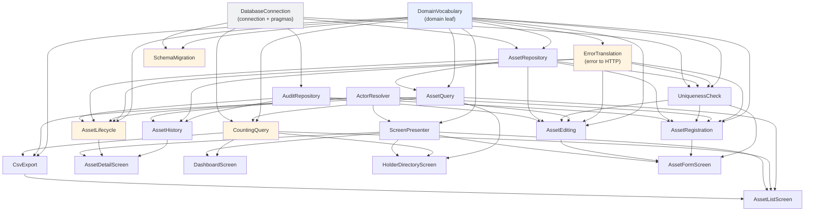

# Components

Asset Tracker MVP — domain design.

This document is the release's **component catalogue**: the logical building
blocks the system is made of, the entities each owns, and the calls between
them. It is derived from the approved requirements, the story set, the
refined mockups, and the verified code store for the existing application.

A component here is a bounded piece of software with its own business logic,
entities, and lifecycle — **code the team writes**. The database, the stylesheet
and the HTTP framework are dependencies *of* components, never components
themselves.

Three things this document deliberately does not do. It does not choose a
deployment topology — that is Units Generation's job. It does not specify data
types, validation constraints, allowed values, or relationship cardinality —
that is Functional Design's job; entities here are captured at the
**ownership + shape** level only. And it does not pin method names or API
shapes — that is Contract Design's job; the targets this catalogue defines are
components and entities.

---

## Component Catalogue

```yaml
components:
  - name: DomainVocabulary
    summary: The release's single source of domain vocabulary, held in a leaf layer with no data access and no HTTP.
    behaviour: >
      Owns the five status values, the display-label mapping that renders them,
      the eight released transition edges, the shared loss-reason vocabulary
      plus the retirement-specific values the discard reason draws on, the
      normalised uniqueness comparison predicate, the seven audit action
      values, the domain error-code vocabulary, the display-holder rule, and
      the filter dimensions with their accepted values. Every other component
      that needs to know a
      status, a legal transition, a reason, a comparison rule, an action name
      or an error code reads it from here and nowhere else. The layer depends on
      Node built-ins only: it imports no database handle, no HTTP types, and no
      Express. It holds no state, so the vocabulary it exposes is the same for
      every caller in the process.
    responsibilities:
      - The single definition of the five exclusive status buckets, including the display label each is rendered with.
      - The transition table of the eight released edges, and the assertion that an edge is legal.
      - The shared loss-reason vocabulary and the retirement-specific values layered on it for a discard.
      - The single normalisation-and-comparison predicate for serial or licence key uniqueness, used by both the application-level check and the database index expression.
      - The audit action vocabulary of exactly seven values.
      - The domain error-code vocabulary of exactly nine values, with each code's HTTP status and its retryable flag.
      - The five filter dimensions the asset list's form exposes, their accepted values, and the normalisation each applies.
      - The holder dimension the filter state carries in addition to those five, and the display-holder matching it applies.
      - The directory's own holder-search dimension, a free-text match over the display-holder name.
      - The single display-holder rule: the current holder where one exists, otherwise the preserved previous holder, otherwise the reserved "Unassigned" designation. The rule also states that the two holder fields never echo one another — the current holder is the current holder and the preserved previous holder is the preserved previous holder — and that the reserved designation applies only to an asset that has never been held by anyone.
    depends_on: []
    dependents:
      - component: AssetLifecycle
        interaction: Reads the transition table to decide whether an edge is legal, the audit action vocabulary to label the entry it appends, and the error vocabulary to refuse an illegal edge.
        style: sync
      - component: AssetRegistration
        interaction: Reads the status vocabulary to create an asset in stock, the uniqueness predicate to refuse a collision, and the error vocabulary to carry the refusal.
        style: sync
      - component: AssetEditing
        interaction: Reads the uniqueness predicate to refuse a colliding serial or key on an edit, against the category the edit sets, and the error vocabulary to carry the refusal.
        style: sync
      - component: UniquenessCheck
        interaction: Uses the normalisation predicate as the one shared definition, so the application check and the database index expression cannot disagree, and reads the error vocabulary to map a busy or a collision onto its code.
        style: sync
      - component: AssetRepository
        interaction: Validates an incoming asset against the status set, so a row can never be written with a status outside the five buckets.
        style: sync
      - component: CountingQuery
        interaction: Reads the five status values to build its bucket aggregation, and the filter dimensions to build its WHERE clause.
        style: sync
      - component: AssetQuery
        interaction: Reads the filter dimensions and the status values to build the list query and the holder grouping.
        style: sync
      - component: CsvExport
        interaction: Reads the status vocabulary to write the Status column of each row.
        style: sync
      - component: ScreenPresenter
        interaction: Reads the display-label mapping to render a status chip, a status filter option, and the per-status action controls.
        style: sync
      - component: ErrorTranslation
        interaction: Reads the error vocabulary to translate each domain code into its HTTP status and its retryable flag.
        style: sync
      - component: SchemaMigration
        interaction: Reads the status vocabulary and the audit action vocabulary to rebuild the schema's CHECK constraint and its audit table.
        style: sync
    external_dependencies: []
    entities: []

  - name: ActorResolver
    summary: Resolves the identity of whoever caused a write, from a trusted server-side context, under the actor-trust rule.
    behaviour: >
      Answers one question: who caused this write. The answer is resolved by
      the server from a context the client cannot influence, and the resolved
      value is a stable display identity that a person reading the history can
      recognise. A request that supplies an actor in a body field, a query
      parameter, or a directly settable header has that supplied value
      ignored, not rejected and not sanitised into acceptance; the
      server-resolved identity is used in its place, and the supplied value is
      neither persisted nor logged. The mechanism behind the resolution is
      deliberately not chosen at this stage — it remains open question OQ1 —
      so this component is specified by its interface and by the trust rule it
      enforces, and the mechanism sits behind that interface. The rule that a
      request-supplied actor is ignored lives here, once, so that two
      different callers cannot implement it differently.
    responsibilities:
      - The single implementation of the actor-trust rule: a client-supplied actor is ignored and the server-resolved value is used.
      - The resolution of a stable, displayable actor identity for a request.
      - The read-only actor identity the "Acting as" indicator renders on every screen.
      - The distinction between a person-attributed entry and a system-attributed entry, so a backfilled entry renders distinguishably.
    depends_on: []
    dependents:
      - component: AssetLifecycle
        interaction: Resolves the actor for each transition, so the asset write and its audit entry carry the same attribution.
        style: sync
      - component: AssetRegistration
        interaction: Resolves the actor for the registration entry.
        style: sync
      - component: AssetEditing
        interaction: Resolves the actor for the edit entry.
        style: sync
      - component: ScreenPresenter
        interaction: Supplies the read-only actor identity the "Acting as" indicator renders.
        style: sync
      - component: AssetHistory
        interaction: Resolves the display identity recorded on each audit entry, so the history reads by actor rather than by an opaque key.
        style: sync
    external_dependencies: []
    entities: []

  - name: ErrorTranslation
    summary: The single translation point from a domain error code to an HTTP status and a retryable flag.
    behaviour: >
      Converts the release's domain errors into what the client sees. It reads
      the code off the error's machine-readable `code` property and never off
      its message text, so a code's meaning is the code and the prose beside
      it is free to change. Every code in the vocabulary is mapped: there is
      no code that reaches the client as an unmapped internal error. The
      invalid-state code is mapped here, closing the gap the current
      application leaves open, where an unknown-state asset is thrown but not
      handled and therefore surfaces as a 500 rather than as a 400. The
      busy code is mapped as retryable, so a caller that receives it knows to
      try again rather than to give up. A driver error that carries no domain
      code is not translated into a domain code: it stays an internal error,
      because translating an unknown failure into a domain code would invent
      a meaning the release has not defined.

      The direction of the dependency is stated here rather than left to be
      inferred. **The domain components raise refusals carrying a domain code;
      they do not ask for an HTTP status.** `ErrorTranslation` is read by the
      HTTP boundary — the Express error middleware, which ADR-001 places in the
      External Dependencies rather than in the component model — and it is the
      boundary, not the service layer, that turns a raised domain error into a
      response. The domain layer therefore never learns what an HTTP status
      is, and the services' dependency on this component is a dependency on
      the *vocabulary of codes*, not an upward reach into HTTP.
    responsibilities:
      - The translation of each domain error code into its HTTP status, drawn from the vocabulary.
      - The mapping of the invalid-state code, which the current middleware leaves unmapped and therefore surfaces as a 500.
      - The marking of the busy code as retryable.
      - The refusal to translate an unmapped driver error into a domain code.
    depends_on:
      - component: DomainVocabulary
        interaction: Reads the error-code vocabulary to obtain each code's HTTP status and its retryable flag.
        style: sync
    dependents:
      - component: AssetLifecycle
        interaction: Raises its refusals carrying a domain code from the vocabulary; the HTTP boundary translates them.
        style: sync
      - component: AssetRegistration
        interaction: Raises a validation or collision refusal carrying a domain code; the HTTP boundary translates it.
        style: sync
      - component: AssetEditing
        interaction: Raises a validation or collision refusal carrying a domain code; the HTTP boundary translates it.
        style: sync
      - component: UniquenessCheck
        interaction: Raises the busy and duplicate-serial codes; the HTTP boundary translates them.
        style: sync
      - component: AssetHistory
        interaction: Raises the not-found refusal carrying a domain code; the HTTP boundary translates it.
        style: sync
    external_dependencies: []
    entities: []

  - name: AssetRepository
    summary: Owns every SQL statement the application makes about assets, and every write to the asset row.
    behaviour: >
      Holds all asset persistence: reading an asset, writing one, and updating
      one. Every statement is a prepared statement with bound parameters; a
      user-supplied value is never interpolated into SQL. The sort column and
      the sort direction are whitelisted to literals rather than parameterised,
      and a filter value outside its accepted set is dropped rather than
      treated as a match. Writing a status outside the five buckets is
      refused. The repository performs no transition validation and writes no
      audit entry: the transition is validated and the audit entry appended by
      the component that owns the write path, so that neither can be bypassed
      by a caller reaching the repository directly.
    responsibilities:
      - The persistence of the asset row, including the current holder, the preserved previous holder, and the lifecycle timestamps.
      - The validation of an asset's category, name, and serial or key against the accepted vocabulary.
      - The refusal of a write carrying a status outside the five exclusive buckets.
      - The prepared-statement discipline and the whitelisted sort column.
    depends_on:
      - component: DomainVocabulary
        interaction: Validates an incoming asset against the status set and the accepted category and filter values.
        style: sync
      - component: DatabaseConnection
        interaction: Supplies the configured handle the asset statements run against.
        style: sync
    dependents:
      - component: AssetLifecycle
        interaction: Reads and writes the asset row inside the transition's transaction.
        style: sync
      - component: AssetRegistration
        interaction: Writes the new asset row inside the registration's transaction.
        style: sync
      - component: AssetEditing
        interaction: Reads and writes the asset row inside the edit's transaction.
        style: sync
      - component: AssetQuery
        interaction: Supplies the filtered, sorted asset rows the list and the directory read.
        style: sync
      - component: UniquenessCheck
        interaction: Supplies the asset rows the uniqueness lookup searches for a collision.
        style: sync
    external_dependencies:
      - name: SQLite Database
        kind: database
        purpose: The single machine-local database file holding the asset and audit tables.
    entities:
      - name: Asset
        identifier: id
        attributes: [name, category, serial_or_key, model, notes, status, assigned_to, last_assigned_to, assigned_at, returned_at, created_at, updated_at]
        references: []

  - name: AuditRepository
    summary: Owns every SQL statement the application makes about audit entries, and is append-only in what it will do.
    behaviour: >
      Appends audit entries and reads them. It never updates an audit entry and
      never deletes one: append-only is enforced by the database itself
      through triggers installed by the schema rebuild, and this component
      exposes no operation that would issue an update or a delete against the
      audit table. It reads an asset's full history, ordered newest first,
      and not merely the latest entry — the full sequence is the release's
      requirement, and the previous shape of a single latest entry is what the
      release replaces. The actor attribute is written on every entry.
    responsibilities:
      - The append of one audit entry, carrying its action, its description, its actor, and its timestamp.
      - The read of an asset's complete audit history, newest first.
      - The refusal to expose any update or delete against the audit table.
    depends_on:
      - component: DatabaseConnection
        interaction: Supplies the configured handle the audit statements run against.
        style: sync
    dependents:
      - component: AssetLifecycle
        interaction: Appends the transition's audit entry inside the same transaction as the asset write.
        style: sync
      - component: AssetRegistration
        interaction: Appends the registration's audit entry inside the same transaction as the asset insert.
        style: sync
      - component: AssetEditing
        interaction: Appends the edit's audit entry inside the same transaction as the asset update.
        style: sync
      - component: AssetHistory
        interaction: Supplies the ordered history sequence the detail screen renders.
        style: sync
    external_dependencies:
      - name: SQLite Database
        kind: database
        purpose: The same single database file, holding the audit table and its append-only triggers.
    entities:
      - name: AuditEntry
        identifier: id
        attributes: [asset_id, action, description, actor, created_at]
        references:
          - entity: Asset
            owned_by: AssetRepository
            relationship: each audit entry records one asset's change; the entry is retained when the asset's history is preserved.

  - name: AssetQuery
    summary: Builds the filtered, sorted asset queries the list and the holder directory read from.
    behaviour: >
      Turns a filter into a query over assets and returns rows. The filter has
      exactly five dimensions **that its form exposes** — a free-text search
      over the name and the serial or key, a category, a status, a sort column
      and a sort direction — and the release adds no sixth to that form. The
      filter definition itself carries one further dimension, a **holder**, and
      the distinction matters: the form's five are the dimensions a person
      types into a control, while the filter's dimensions are everything a
      filter state can carry. The holder dimension is set by the directory's
      holder-row link, which navigates to the asset list filtered to that
      holder, and it is not a control on the list's filter form — the list's
      form is unchanged, and the criterion that fixes the form's five
      dimensions is untouched. The holder dimension is nonetheless part of the
      filter **state**, and the list's reset clears it along with the form's
      five, so that the reset returns the list to the unfiltered state on
      every path into it. The same filter definition serves the list's
      rows, the directory's holder grouping, the dashboard's figures, and the
      export's rows, so that the four count-consuming surfaces are selecting
      from one definition rather than four. This component returns rows; it
      does not count them.
    responsibilities:
      - The construction of the filtered and sorted asset query from a filter definition.
      - The free-text search over the name and the serial or key.
      - The holder dimension, applied to the display holder rather than to the asset's fields, and cleared by the list's reset.
      - The grouping of assets by display holder for the directory.
      - The supply of the matching row set to the list, the directory, and the export.
    depends_on:
      - component: DomainVocabulary
        interaction: Reads the filter dimensions and their accepted values, and the display-holder rule.
        style: sync
      - component: AssetRepository
        interaction: Executes the asset reads the query defines.
        style: sync
    dependents:
      - component: AssetListScreen
        interaction: Supplies the list's rendered rows for the applied filter.
        style: sync
      - component: HolderDirectoryScreen
        interaction: Supplies the assets grouped by display holder.
        style: sync
      - component: CsvExport
        interaction: Supplies the matching row set the export writes.
        style: sync
      - component: CountingQuery
        interaction: Shares the one filter definition and the one query construction, so a count and the rows it counts agree.
        style: sync
    external_dependencies: []
    entities: []

  - name: CountingQuery
    summary: Computes every figure the release displays, from one shared counting definition over the database.
    behaviour: >
      Produces the numbers, and only the numbers. It answers for the five
      bucket counts, the active inventory, the total record count, the count
      of assets available to assign, the list's shown and matching figures,
      and the directory's count of distinct display holders. The counts come
      from an aggregation in the database rather than from the asset set
      loaded into memory, so the counting path's own row count does not grow
      with the number of assets. Every count is computed from the same filter
      definition the row queries use, so the dashboard, the directory, the
      list, and the export agree with each other by construction. The
      distinction between the active inventory and the total record count is
      this component's: a discarded asset counts towards the total and not
      towards the active inventory. The directory's holder figure is computed
      here too, and it is the figure for the **searched** population — the
      holders currently listed on the screen — so that the count line and the
      rendered rows can never disagree. It is computed from the directory's
      holder-search filter rather than from the asset filter, because it counts
      holders and not assets; but it is computed here, by the one component
      that computes every figure, rather than by the screen that renders it.
    responsibilities:
      - The five bucket counts, which sum to the total record count.
      - The active inventory count, covering every bucket except the discarded one.
      - The total record count, covering every bucket including the discarded one.
      - The count of assets available to assign, being the in-stock bucket.
      - The list's shown and matching figures.
      - The directory's count of distinct display holders, excluding the Unassigned row, for the searched population.
      - The per-holder per-bucket breakdown, whose chips sum to the holder's total.
    depends_on:
      - component: DomainVocabulary
        interaction: Reads the five status values to build the bucket aggregation and the filter dimensions to build the WHERE clause.
        style: sync
      - component: AssetQuery
        interaction: Shares the one filter definition and the one query construction, so a count and the rows it counts agree.
        style: sync
      - component: DatabaseConnection
        interaction: Supplies the configured handle the aggregation runs against.
        style: sync
    dependents:
      - component: DashboardScreen
        interaction: Supplies every figure the dashboard renders.
        style: sync
      - component: AssetListScreen
        interaction: Supplies the list's shown and matching figures.
        style: sync
      - component: HolderDirectoryScreen
        interaction: Supplies the directory's count of distinct display holders and each holder's per-bucket breakdown.
        style: sync
      - component: CsvExport
        interaction: Supplies the matching row count the export's row count is asserted against.
        style: sync
    external_dependencies:
      - name: SQLite Database
        kind: database
        purpose: The aggregation is computed by the database, not by loading the asset set into memory.
    entities: []

  - name: AssetLifecycle
    summary: Owns the eight released lifecycle transitions, and makes each one a single all-or-nothing write of the asset and its audit entry.
    behaviour: >
      Executes a transition: it validates that the edge is legal from the
      asset's current status, applies the transition's side effects, and
      appends the audit entry naming the transition. The asset write and the
      audit append happen inside one transaction, so a failure cannot leave a
      changed asset with no audit entry — the silent failure the release
      exists to remove. An illegal edge is refused with the invalid-transition
      code and writes no audit entry. The side effects are the release's:
      assigning sets the current holder, the assignment timestamp, and clears
      the return timestamp; returning clears the current holder, sets the
      return timestamp, and leaves the assignment timestamp unchanged; a loss
      records the departing current holder into the preserved previous-holder
      field before clearing the current holder, so a lost asset that had been
      held remains attributable to the person who last held it, and only a
      loss of a never-held asset clears both holder fields; a recovery moves
      the asset back to stock, is recorded as a distinct recovered action
      rather than as an assign or a return, and names the recovery and the
      prior holder; a discard resolves the assignment inline, recording the
      holder at discard time into the preserved previous-holder field before
      clearing the current holder, and records the discard, the prior holder,
      and the fact that the assignment was resolved by the discard. A loss, a
      recovery, and a discard each require a reason drawn from the shared
      vocabulary; a reason-less request is refused with no status change, no
      holder change, and no audit entry. It also owns the refusal of a delete
      against an asset row: the delete is refused with the delete-refusal code,
      the asset row and all its audit entries are left intact, and the refusal
      is a domain error rather than a bare database failure.
    responsibilities:
      - The legality check for each of the eight released edges, and the refusal of every other edge.
      - The transition's side effects on status, the current holder, the preserved previous holder, and the lifecycle timestamps.
      - The single transaction covering the asset write and the audit append, on every transition.
      - The audit description naming the specifics of each transition: the holder affected, the prior holder where one applies, and the reason where the transition requires one.
      - The distinct recovered and discarded audit actions, distinct from assign and return.
      - The refusal of a delete against an asset row, with the delete-refusal code, leaving the row and its history intact.
    depends_on:
      - component: DomainVocabulary
        interaction: Reads the transition table to decide legality, the status and reason vocabularies to validate the request, the audit action vocabulary to label the entry, and the error vocabulary to carry a refusal.
        style: sync
      - component: ErrorTranslation
        interaction: Raises refusals carrying a domain code from the error vocabulary.
        style: sync
      - component: ActorResolver
        interaction: Resolves the actor the entry is attributed to.
        style: sync
      - component: AssetRepository
        interaction: Reads and writes the asset row inside the transition's transaction.
        style: sync
      - component: AuditRepository
        interaction: Appends the transition's audit entry inside the same transaction as the asset write.
        style: sync
    dependents:
      - component: AssetDetailScreen
        interaction: Executes the transition the administrator picks, and reports the asset's new state and the appended entry together.
        style: sync
    entities: []

  - name: AssetRegistration
    summary: Registers a new asset in stock, with its uniqueness checked and its creation recorded.
    behaviour: >
      Creates an asset from the registration request. The asset is created in
      the in-stock bucket and is assigned to nobody: the registration form
      offers no assignee field, and custody is recorded by the lifecycle
      transitions rather than at registration. The serial or key is checked
      for uniqueness under the one shared policy, and a collision is refused
      with the duplicate-serial code. The asset insert and the creation audit
      entry happen inside one transaction, so a registration cannot succeed
      without its entry. The creation entry's description names the
      registered asset's name, its category, and the serial or key it was
      registered under.
    responsibilities:
      - The creation of a new asset in the in-stock bucket with no holder.
      - The uniqueness check on the registration's serial or key, under the shared policy.
      - The single transaction covering the asset insert and the creation audit entry.
      - The creation audit entry's description naming the asset, its category, and its serial or key.
    depends_on:
      - component: DomainVocabulary
        interaction: Reads the status vocabulary to create the asset in stock and the uniqueness predicate to refuse a collision.
        style: sync
      - component: ErrorTranslation
        interaction: Raises refusals carrying a domain code from the error vocabulary.
        style: sync
      - component: ActorResolver
        interaction: Resolves the actor the creation entry is attributed to.
        style: sync
      - component: UniquenessCheck
        interaction: Asks the one component that owns the uniqueness policy whether the serial or key collides.
        style: sync
      - component: AssetRepository
        interaction: Writes the new asset row inside the registration's transaction.
        style: sync
      - component: AuditRepository
        interaction: Appends the creation audit entry inside the same transaction as the asset insert.
        style: sync
    dependents:
      - component: AssetFormScreen
        interaction: Executes the registration the administrator submits.
        style: sync
    external_dependencies: []
    entities: []

  - name: AssetEditing
    summary: Corrects an asset's editable fields, with the uniqueness policy applied against the category the edit sets.
    behaviour: >
      Applies an edit to an asset's category, name, model, notes, and serial
      or licence key. The status, the current holder, and the preserved
      previous holder are not editable and are left untouched whatever the
      request carries. The uniqueness policy is applied on the same terms as
      at registration, and it is applied against the category the edit sets,
      so a serial that collides within the new category is refused and one
      that collides only within the old category is accepted. An edit that
      changes no field appends no audit entry and does not change the asset's
      update timestamp; an edit that changes at least one field appends
      exactly one entry naming the changed fields and their previous values.
      The asset update and the audit append happen inside one transaction.
    responsibilities:
      - The application of an edit to the five editable fields, and the refusal to edit the status or either holder field.
      - The uniqueness check for the edited serial or key, against the category the edit sets.
      - The edit's single audit entry, naming the changed fields and their previous values.
      - The single transaction covering the asset update and the audit append.
    depends_on:
      - component: DomainVocabulary
        interaction: Reads the uniqueness predicate to refuse a colliding serial or key, and the audit action vocabulary to label the entry.
        style: sync
      - component: ErrorTranslation
        interaction: Raises refusals carrying a domain code from the error vocabulary.
        style: sync
      - component: ActorResolver
        interaction: Resolves the actor the edit entry is attributed to.
        style: sync
      - component: UniquenessCheck
        interaction: Asks the one component that owns the uniqueness policy whether the edited serial or key collides, excluding the asset being edited.
        style: sync
      - component: AssetRepository
        interaction: Reads and writes the asset row inside the edit's transaction.
        style: sync
      - component: AuditRepository
        interaction: Appends the edit audit entry inside the same transaction as the asset update.
        style: sync
    dependents:
      - component: AssetFormScreen
        interaction: Executes the edit the administrator submits.
        style: sync
    external_dependencies: []
    entities: []

  - name: UniquenessCheck
    summary: The one place that decides whether a serial or licence key collides, for registration, for an edit, and for the inline warning.
    behaviour: >
      Applies one normalisation-and-comparison definition: the serial or key
      is trimmed of leading and trailing whitespace and case-folded, and it is
      compared within a category. The stored value keeps the user's own
      casing and spacing; the normalisation exists to compare, not to store.
      The definition is the same one the database's functional unique index
      uses, so the two tiers cannot disagree about what a collision is. The
      check serves three callers, and it serves them under **two transaction
      disciplines** that share one definition. The **authoritative** check —
      the one the registration path and the edit path act on — runs inside an
      immediate transaction with a non-zero busy timeout, so a concurrent
      writer waits for the lock rather than failing immediately, and a lock
      that cannot be acquired within the timeout surfaces as the retryable
      busy condition rather than as a generic internal error. The **advisory**
      lookup — the one the inline warning shows, issued when the serial field
      loses focus — runs inside a deferred read transaction and takes no
      write lock, so it cannot block another writer on the single database
      file and cannot surface a busy condition to a user who is typing. The
      two disciplines differ; the comparison they perform does not, which is
      what keeps the advisory answer and the authoritative answer in
      agreement. Two failure classes are kept apart: a duplicate is a
      permanent validation-class failure carried by one code that both tiers
      raise, and a busy condition is transient and is carried by a different,
      retryable code, raised only by the authoritative check. Both are
      detected from the driver's machine-readable error codes and never by
      matching error message text. The check excludes the asset being edited
      from its own comparison.
    responsibilities:
      - The single normalisation-and-comparison definition for a serial or licence key, shared with the database's unique index expression.
      - The collision lookup, scoped to a category and excluding the asset being edited.
      - The authoritative check's immediate-transaction and busy-timeout discipline.
      - The advisory lookup's deferred read transaction, which takes no write lock and raises no busy condition.
      - The two-tier error codes: the duplicate-serial code raised by both the application predicate and the unique index, and the distinct retryable code for a busy condition.
      - The distinction between the advisory answer the inline warning shows and the authoritative answer the write path acts on, and the guarantee that they answer the same question.
    depends_on:
      - component: DomainVocabulary
        interaction: Uses the normalisation predicate as the one shared definition, and reads the error vocabulary to map a busy or a collision onto its code.
        style: sync
      - component: ErrorTranslation
        interaction: Raises refusals carrying a domain code from the error vocabulary.
        style: sync
      - component: AssetRepository
        interaction: Reads the asset rows the comparison runs against.
        style: sync
      - component: DatabaseConnection
        interaction: Supplies the configured handle, and with it the non-zero busy timeout the immediate transaction depends on.
        style: sync
    dependents:
      - component: AssetRegistration
        interaction: Refuses a colliding registration under the one policy.
        style: sync
      - component: AssetEditing
        interaction: Refuses a colliding edit under the one policy, against the category the edit sets.
        style: sync
      - component: AssetFormScreen
        interaction: Supplies the advisory answer the inline duplicate warning shows, from a read that takes no write lock.
        style: sync
    external_dependencies:
      - name: SQLite Database
        kind: database
        purpose: The functional unique index is the authoritative arbiter of a collision; the application predicate exists to give a prompt, specific refusal.
    entities: []

  - name: AssetHistory
    summary: Assembles an asset's complete audit history for display, with each entry's actor and its system marker.
    behaviour: >
      Returns the asset's audit sequence newest first, with every entry's
      actor, and marks the entries attributed to the system actor distinctly
      from the entries attributed to a person so a reader can tell them
      apart. The sequence is the asset's complete history: entries are not
      replaced by a single latest entry. This is a read-only component; it
      appends nothing and changes nothing.
    depends_on:
      - component: AuditRepository
        interaction: Supplies the ordered history sequence.
        style: sync
      - component: ErrorTranslation
        interaction: Raises refusals carrying a domain code from the error vocabulary.
        style: sync
      - component: ActorResolver
        interaction: Supplies the distinction between a person-attributed entry and a system-attributed one.
        style: sync
    dependents:
      - component: AssetDetailScreen
        interaction: Supplies the history sequence the detail screen renders.
        style: sync
    external_dependencies: []
    entities: []

  - name: CsvExport
    summary: Writes the filtered asset list as a CSV file, with every string cell protected against formula injection.
    behaviour: >
      Produces the export of the assets matching the asset list's current
      filter. Its row set is the list's matching row set, and it does not
      truncate that row set. The file carries exactly six columns in a fixed
      order — the name, the category, the serial or key, the status, the
      holder, and the last holder — and neither the notes nor the audit
      history is exported, because neither is a column of the list the export
      mirrors. The file is named for its purpose, is served with the CSV
      content type, is encoded as UTF-8, and is served with the content-type
      header that stops a browser treating it as markup. A cell whose content
      begins with the equals sign, a plus, a minus, an at sign, a tab, or a
      carriage return is prefixed with a single quote before quoting, and the
      protection is applied to every string cell rather than to a selected
      subset of columns, because the free-text columns are where a
      user-supplied value would begin with such a character. When no rows
      match, the file carries the header and no data rows. The export contains
      no filter metadata beyond its header and its data rows.
    responsibilities:
      - The construction of the six-column CSV, with the fixed column order.
      - The formula-injection escaping, applied to every string cell through one shared function.
      - The file's name, content type, and encoding, and the header that prevents the response being sniffed as markup.
      - The header-only file when no rows match, and the untruncated row set otherwise.
    depends_on:
      - component: DomainVocabulary
        interaction: Reads the status vocabulary to write the status column.
        style: sync
      - component: AssetQuery
        interaction: Supplies the matching row set the export writes.
        style: sync
      - component: CountingQuery
        interaction: Supplies the matching row count the export's row count is asserted against.
        style: sync
    dependents:
      - component: AssetListScreen
        interaction: Offers the export of the list's current filter.
        style: sync
    external_dependencies: []
    entities: []

  - name: DatabaseConnection
    summary: Opens the single database connection and owns the connection-level pragmas the release's concurrency guarantees depend on.
    behaviour: >
      Opens the application's one database handle and configures it. The
      configuration it owns is not incidental: the busy timeout is a
      connection-level setting, not a per-call one, and it is what lets a
      concurrent writer wait for the lock rather than failing immediately.
      The release requires that timeout to be non-zero **at the time the
      uniqueness check runs**, and today it is never set at all — its
      effective value is an accident of the driver rather than a choice. This
      component therefore sets it explicitly at open time, alongside the
      journal mode and the foreign-keys setting. The foreign-keys setting is
      on by default here, but the migration controls its own pragma window,
      because the migration runner can be invoked against a connection on
      which foreign keys are off. The component hands the configured handle
      to the components that use it and exposes no query of its own.
    responsibilities:
      - The opening of the single machine-local database handle.
      - The explicit, non-zero busy timeout the uniqueness check's IMMEDIATE transaction depends on.
      - The journal mode and the foreign-keys setting on the opened handle.
      - The handing of the configured handle to the components that use it, and no query of its own.
    depends_on: []
    dependents:
      - component: AssetRepository
        interaction: Supplies the configured handle the asset statements run against.
        style: sync
      - component: AuditRepository
        interaction: Supplies the configured handle the audit statements run against.
        style: sync
      - component: CountingQuery
        interaction: Supplies the configured handle the aggregation runs against.
        style: sync
      - component: UniquenessCheck
        interaction: Supplies the configured handle, and with it the non-zero busy timeout the immediate transaction depends on.
        style: sync
      - component: SchemaMigration
        interaction: Supplies the handle the rebuild runs against.
        style: sync
    external_dependencies:
      - name: SQLite Database
        kind: database
        purpose: The single machine-local database file the application opens.
    entities: []

  - name: SchemaMigration
    summary: Rebuilds the asset and audit tables as one indivisible migration, with the ordering that preserves the audit history.
    behaviour: >
      Performs the release's schema change as one unit. The audit table is
      rebuilt first without its foreign-key clause, the asset table is
      rebuilt second, and the foreign key is re-added only after that — this
      ordering is binding, because dropping the asset table first fires the
      audit table's cascading delete and destroys every audit row with the
      transaction committed and no error raised, while the reverse order
      fails with a foreign-key error. The migration controls the foreign-keys
      pragma itself, because the migration runner can be invoked against a
      connection on which foreign keys are off. The migration re-issues the
      index definitions, because a rebuild destroys the indexes on the
      rebuilt table. It installs the triggers that make the audit table
      refuse an update and refuse a delete at the database level, so that the
      append-only guarantee does not depend on application code. It backfills
      the pre-existing audit history to the system actor, preserving every
      original record and its traceability; the backfill is idempotent, it
      counts and reports its failures with row identifiers and reasons, and a
      single failing row fails the migration and rolls the backfill back,
      so a partial backfill never reaches a deployment.
    responsibilities:
      - The ordered rebuild of the audit table and then the asset table, with the foreign key re-added afterwards.
      - The explicit control of the foreign-keys pragma across the rebuild window.
      - The re-issue of the index definitions the rebuild destroys.
      - The installation of the append-only triggers on the audit table.
      - The idempotent, failure-counting, fail-the-migration backfill of the pre-existing audit history to the system actor.
    depends_on:
      - component: DomainVocabulary
        interaction: Reads the status vocabulary and the audit action vocabulary to rebuild the schema's CHECK constraint and its audit table.
        style: sync
      - component: DatabaseConnection
        interaction: Supplies the handle the rebuild runs against.
        style: sync
    dependents: []
    external_dependencies:
      - name: SQLite Database
        kind: database
        purpose: The migration runs against the same single database file the application opens.
    entities: []

  - name: ScreenPresenter
    summary: Turns a screen's domain data into the rendered markup, and resolves the shared status display mapping.
    behaviour: >
      Assembles what a screen renders, and it is the one place the status
      display mapping is applied: the stored status value, its display label,
      and the chip class that carries it are three things, and all three are
      resolved from the one mapping so that the list's chips, the list's
      status filter options, the detail screen's chip, and the directory's
      per-holder chips cannot drift apart. The presenter receives the
      vocabulary a template renders as render data rather than as a literal
      copy — the status options in the filter form, the per-status action
      controls on the detail screen, and the reason options in the dialog are
      all supplied from the domain vocabulary. It also holds the shared
      chrome every screen carries: the skip link that is the first focusable
      element, the top bar, the navigation, and the read-only actor
      indicator.
    responsibilities:
      - The single status display mapping, resolving the stored value to its label and its chip class.
      - The supply of the status options, the per-status action controls, and the reason options to the templates as render data.
      - The shared page chrome: the skip link, the top bar, the navigation, and the read-only actor indicator.
      - The accessibility affordances every released screen carries, including the per-screen accessibility note.
    depends_on:
      - component: DomainVocabulary
        interaction: Reads the status display mapping, the transition table, the reason vocabularies, and the audit action vocabulary to render the screens.
        style: sync
      - component: ActorResolver
        interaction: Supplies the read-only actor identity the indicator renders.
        style: sync
    dependents:
      - component: AssetListScreen
        interaction: Renders the list's chrome, its count line, and its status-filtered options.
        style: sync
      - component: AssetDetailScreen
        interaction: Renders the detail screen's chrome, its status chip, its action controls, and its announcement region.
        style: sync
      - component: DashboardScreen
        interaction: Renders the dashboard's chrome and its status-labelled tiles.
        style: sync
      - component: HolderDirectoryScreen
        interaction: Renders the directory's chrome and its per-holder chips.
        style: sync
      - component: AssetFormScreen
        interaction: Renders the form's chrome and its reason and status options.
        style: sync
    external_dependencies: []
    entities: []

  - name: AssetListScreen
    summary: The screen that lists and filters the assets, and reports how many records are shown and how many match.
    behaviour: >
      Presents the asset list. It renders the filter form, the count line,
      the results table, and the export control, and it offers a reset that
      clears every filter dimension in one action — the form's five and the
      holder dimension alike, so the reset always returns the list to the
      unfiltered state whose matching count is the total record count. Its
      count line carries two
      figures: how many records the screen is rendering, and how many records
      match the applied filter. The shown figure never exceeds the matching
      figure. The table's six columns keep the current holder and the
      preserved previous holder apart — the two fields never fall back to one
      another, so a currently-held asset shows an empty last holder and a
      released asset shows an empty current holder. Each bucket tile elsewhere
      in the release links here with a filter applied, and a holder row links
      here with a filter applied: the filtered list is a filter state of this
      screen, not a separate screen.
    responsibilities:
      - The rendering of the filtered asset list and its filter form.
      - The count line's shown and matching figures, and the reset action, which clears every dimension of the filter state including the holder.
      - The results table with the six columns, keeping the two holder fields separate.
      - The link target for the dashboard's bucket tiles and the directory's holder rows.
    depends_on:
      - component: AssetQuery
        interaction: Supplies the rendered rows for the applied filter.
        style: sync
      - component: CountingQuery
        interaction: Supplies the shown and matching figures.
        style: sync
      - component: ScreenPresenter
        interaction: Renders the screen's chrome, its count line, and its status options.
        style: sync
      - component: CsvExport
        interaction: Offers the export of the list's current filter.
        style: sync
    dependents: []
    external_dependencies: []
    entities: []

  - name: AssetDetailScreen
    summary: The screen that shows one asset's record, its history, and the actions legal from its current status.
    behaviour: >
      Presents an asset. It renders the asset's fields, the actions legal
      from the asset's current status, the asset's complete history newest
      first with an actor on every entry, and the notes. The action controls
      are exactly those whose released edge originates at the current status,
      so the screen offers no action the release would refuse. A transition
      that the release refuses is reported in words, stating that it was
      refused and what the asset's status now is, without showing an error
      code. A status change is announced in the returned markup, so the
      change is conveyed to assistive technology and not only to the eye. A
      discarded asset stays reachable at this URL with its history intact,
      and the screen states what the discard did and what survived it.
    responsibilities:
      - The rendering of an asset's fields, its notes, and its status chip.
      - The action controls legal from the asset's current status, and the reason dialog each one opens.
      - The rendering of the asset's complete history, newest first, with an actor on every entry.
      - The announcement of a status change, and the statement of a refused transition.
      - The discarded-asset note, and the continued reachability of a discarded asset's detail URL.
    depends_on:
      - component: AssetHistory
        interaction: Supplies the history sequence the screen renders.
        style: sync
      - component: AssetLifecycle
        interaction: Executes the transition the administrator picks.
        style: sync
      - component: ScreenPresenter
        interaction: Renders the screen's chrome, its chip, and its action controls.
        style: sync
    dependents: []
    external_dependencies: []
    entities: []

  - name: DashboardScreen
    summary: The reconciliation screen, showing every bucket, the active inventory, the total, and the two attention counts.
    behaviour: >
      Presents the inventory at a glance. It renders the five bucket tiles,
      the active inventory figure, the total record count figure, the count
      of assets available to assign, and an attention panel carrying two
      separate items — the lost count and the discarded count — each a whole
      bucket count with no time window applied to either. The figures
      reconcile by construction: the bucket tiles sum to the total record
      count, and the active inventory equals the sum of the buckets it
      covers, because all of them are read from the one counting component.
      Each bucket tile links to the asset list filtered to that bucket, so a
      reader can reach the assets behind a figure.
    responsibilities:
      - The rendering of the five bucket tiles, the active inventory, the total record count, and the available-to-assign count.
      - The rendering of the attention panel's two separate whole-bucket counts.
      - The reconciliation of the tiles to the total and of the active inventory to the buckets it covers.
      - The link from each bucket tile to the asset list filtered to that bucket.
    depends_on:
      - component: CountingQuery
        interaction: Supplies every figure the dashboard renders.
        style: sync
      - component: ScreenPresenter
        interaction: Renders the screen's chrome and its status-labelled tiles.
        style: sync
    dependents: []
    external_dependencies: []
    entities: []

  - name: HolderDirectoryScreen
    summary: The screen listing every distinct display holder, with each holder's total and per-bucket breakdown.
    behaviour: >
      Presents the directory. It renders one row per distinct display holder
      plus the Unassigned row, and the count line states what it counts — the
      distinct display holders, excluding the Unassigned row, because
      Unassigned is a row and not a holder — so the count line and the
      rendered rows can never disagree: when the Unassigned row is present
      the rendered row count is one greater than the figure. The figure
      reports the currently listed population, so a holder search narrows the
      figure with the rows, and the figure is read from the counting
      component rather than computed on the screen. The holder search filters
      the **holder rows**, not the assets: a holder whose name does not match
      is removed from the directory even when that holder holds assets, and a
      matching holder's row, its total, its chips and its expansion are
      unaffected. Each row carries the holder's total and its
      per-bucket chips, and the chips sum to the total. A row expands in place
      to reveal that holder's assets, and each expanded row is marked as
      currently held or as last holder. Each holder row links to the asset
      list filtered to that holder. The holders are derived from the assets
      themselves; a name that appears on no asset is not a row.
    responsibilities:
      - The rendering of one row per distinct display holder plus the Unassigned row.
      - The count line, stating what it counts and reporting the currently listed population.
      - The per-holder total and per-bucket chips, and the reconciliation of the chips to the total.
      - The in-place expansion revealing a holder's assets, marked as currently held or as last holder.
      - The holder search, which filters the holder rows rather than the assets.
      - The link from a holder row to the asset list filtered to that holder.
    depends_on:
      - component: AssetQuery
        interaction: Supplies the assets grouped by display holder.
        style: sync
      - component: CountingQuery
        interaction: Supplies the directory's count of distinct display holders for the searched population, and each holder's per-bucket breakdown.
        style: sync
      - component: ScreenPresenter
        interaction: Renders the screen's chrome and its per-holder chips.
        style: sync
    dependents: []
    external_dependencies: []
    entities: []

  - name: AssetFormScreen
    summary: The screen that registers a new asset and the screen that corrects an existing one, with duplicate detection.
    behaviour: >
      Presents the asset form, in registration mode or in edit mode; the two
      modes are one form with different values. It renders the five editable
      fields, and it does not render a field for the status, the current
      holder, or the preserved previous holder. When the serial or key being
      entered would collide with an existing asset in the same category, it
      shows an inline warning naming the existing asset and linking to it,
      before submission. The warning is advisory: dismissing it leaves the
      form as typed and the submission available. If the submitted value
      collides, the submission is refused, the refusal names the existing
      asset and links to it, and it offers exactly two ways forward — open
      the existing asset, or change the serial or key — with no override. A
      dismissal of the inline warning does not waive the submit-time
      refusal, and a collision across different categories is not a
      collision.
    responsibilities:
      - The rendering of the asset form in registration mode and in edit mode, with the five editable fields and no status or holder field.
      - The inline duplicate warning, shown before submission and naming the existing asset.
      - The submit-time collision block, naming the existing asset, linking to it, and offering exactly the two ways forward.
      - The refusal of a self-collision, where the asset being edited does not collide with itself.
    depends_on:
      - component: UniquenessCheck
        interaction: Supplies the advisory answer the inline warning shows, and the authoritative answer the submit is refused on.
        style: sync
      - component: AssetRegistration
        interaction: Executes the registration the administrator submits.
        style: sync
      - component: AssetEditing
        interaction: Executes the edit the administrator submits.
        style: sync
      - component: ScreenPresenter
        interaction: Renders the form's chrome and its option lists.
        style: sync
    dependents: []
    external_dependencies: []
    entities: []
```

---

## Component Diagram

One node per component, one labelled edge per `depends_on`.



The graph is acyclic, and the diagram is generated from the catalogue's
`depends_on` lists rather than drawn by hand — the two are the same data
presented twice, and a diagram drawn by hand is a second claim that can drift
from the first.

The `DomainVocabulary` node has no incoming edge — it is the leaf, and it
depends on nothing but Node built-ins. `ActorResolver` and
`DatabaseConnection` also have no incoming edge, and each for its own
reason: the resolver owns the trust rule and needs no vocabulary, and the
connection component opens the handle in the first place.

---

## Component Summary

| Component | Purpose | Depends On | Dependents | Entities Owned |
|---|---|---|---|---|
| `DomainVocabulary` | The release's one definition of every domain vocabulary, the error codes included | — | `AssetLifecycle`, `AssetRegistration`, `AssetEditing`, `UniquenessCheck`, `AssetRepository`, `CountingQuery`, `AssetQuery`, `CsvExport`, `ScreenPresenter`, `ErrorTranslation`, `SchemaMigration` | — |
| `ActorResolver` | Resolves the actor of a write from a trusted server-side context | — | `AssetLifecycle`, `AssetRegistration`, `AssetEditing`, `ScreenPresenter`, `AssetHistory` | — |
| `ErrorTranslation` | The one place a domain error code becomes an HTTP status | `DomainVocabulary` | `AssetLifecycle`, `AssetRegistration`, `AssetEditing`, `UniquenessCheck`, `AssetHistory` | — |
| `AssetRepository` | Owns every SQL statement and every write about assets | `DomainVocabulary`, `DatabaseConnection` | `AssetLifecycle`, `AssetRegistration`, `AssetEditing`, `AssetQuery`, `UniquenessCheck` | `Asset` |
| `AuditRepository` | Owns every SQL statement about audit entries; append-only | `DatabaseConnection` | `AssetLifecycle`, `AssetRegistration`, `AssetEditing`, `AssetHistory` | `AuditEntry` |
| `AssetQuery` | Builds the filtered, sorted asset queries | `DomainVocabulary`, `AssetRepository` | `AssetListScreen`, `HolderDirectoryScreen`, `CsvExport`, `CountingQuery` | — |
| `CountingQuery` | Computes every displayed figure from one shared definition | `DomainVocabulary`, `AssetQuery`, `DatabaseConnection` | `DashboardScreen`, `AssetListScreen`, `HolderDirectoryScreen`, `CsvExport` | — |
| `AssetLifecycle` | Owns the eight released transitions; each one one transaction | `DomainVocabulary`, `ErrorTranslation`, `ActorResolver`, `AssetRepository`, `AuditRepository` | `AssetDetailScreen` | — |
| `AssetRegistration` | Registers a new asset in stock, with its entry | `DomainVocabulary`, `ErrorTranslation`, `ActorResolver`, `UniquenessCheck`, `AssetRepository`, `AuditRepository` | `AssetFormScreen` | — |
| `AssetEditing` | Corrects an asset's editable fields, with its entry | `DomainVocabulary`, `ErrorTranslation`, `ActorResolver`, `UniquenessCheck`, `AssetRepository`, `AuditRepository` | `AssetFormScreen` | — |
| `UniquenessCheck` | The one place that decides whether a serial or key collides | `DomainVocabulary`, `ErrorTranslation`, `AssetRepository`, `DatabaseConnection` | `AssetRegistration`, `AssetEditing`, `AssetFormScreen` | — |
| `AssetHistory` | Assembles an asset's complete history for display | `AuditRepository`, `ErrorTranslation`, `ActorResolver` | `AssetDetailScreen` | — |
| `CsvExport` | Writes the filtered list as a CSV, every cell escaped | `DomainVocabulary`, `AssetQuery`, `CountingQuery` | `AssetListScreen` | — |
| `DatabaseConnection` | Opens the database handle and owns the connection-level pragmas | — | `AssetRepository`, `AuditRepository`, `CountingQuery`, `UniquenessCheck`, `SchemaMigration` | — |
| `SchemaMigration` | Rebuilds both tables as one ordered, history-preserving migration | `DomainVocabulary`, `DatabaseConnection` | — | — |
| `ScreenPresenter` | Turns domain data into markup; the one status display mapping | `DomainVocabulary`, `ActorResolver` | `AssetListScreen`, `AssetDetailScreen`, `DashboardScreen`, `HolderDirectoryScreen`, `AssetFormScreen` | — |
| `AssetListScreen` | Lists and filters the assets; reports shown and matching | `AssetQuery`, `CountingQuery`, `ScreenPresenter`, `CsvExport` | — | — |
| `AssetDetailScreen` | Shows one asset, its history, and its legal actions | `AssetHistory`, `AssetLifecycle`, `ScreenPresenter` | — | — |
| `DashboardScreen` | Reconciles the inventory at a glance | `CountingQuery`, `ScreenPresenter` | — | — |
| `HolderDirectoryScreen` | Lists every display holder with their breakdown | `AssetQuery`, `CountingQuery`, `ScreenPresenter` | — | — |
| `AssetFormScreen` | Registers and edits assets, with duplicate detection | `UniquenessCheck`, `AssetRegistration`, `AssetEditing`, `ScreenPresenter` | — | — |

**Twenty-one components.** Eighteen depend on at least one other component;
three depend on none — `DomainVocabulary`, which is the leaf; `ActorResolver`,
which needs no vocabulary; and `DatabaseConnection`, which opens the handle in
the first place.

---

## Entity Ownership

| Entity | Owning Component | Identifier | Attributes | References |
|---|---|---|---|---|
| `Asset` | `AssetRepository` | `id` | `name`, `category`, `serial_or_key`, `model`, `notes`, `status`, `assigned_to`, `last_assigned_to`, `assigned_at`, `returned_at`, `created_at`, `updated_at` | — |
| `AuditEntry` | `AuditRepository` | `id` | `asset_id`, `action`, `description`, `actor`, `created_at` | `Asset` (owned by `AssetRepository`) — each audit entry records one asset's change |

Two entities, two owners, one owner each. There is no `Holder` entity: the
holder is a display name recorded on the asset, and the directory derives its
rows from the assets. There is no `Actor` entity: the actor is an attribution
recorded on an audit entry, and the mechanism that produces it is still an open
question.

The `Asset` entity carries the two holder fields as **strictly
non-falling-back**: `assigned_to` is the current holder, `last_assigned_to` is
the preserved previous holder, and neither ever echoes the other. An asset
that is currently assigned therefore shows an empty preserved previous
holder. The two fields are populated by the transitions that move a holder —
the loss and the discard write the departing current holder into the
preserved previous-holder field before clearing the current holder — and by
nothing else.

**The reserved "Unassigned" designation.** An asset with neither holder is
labelled with the reserved designation "Unassigned", and that designation is
reserved: it applies only to an asset that has **never been held by anyone**,
and it is never a holder's name. The reserved designation is held as a
distinct value rather than as a holder name that happens to read "Unassigned",
so that a holder whose name happens to be that text is distinguishable from
the reserved row — the directory renders the reserved row separately, the
directory's count excludes it, and an asset attributed to it is an asset that
was never held. The label itself is a display value the presenter renders; the
rule that produces it is `DomainVocabulary`'s.

---

## Display Vocabulary

`DomainVocabulary` owns this mapping, and `ScreenPresenter` is the one place it
is applied. The mapping is bound here for the same reason the error codes are
bound above: AC3.1.8 fixes the exact label each status is displayed with, and
binding it here means no criterion that refers to a display label is left
without a literal to refer to.

| Stored value | Display label | The generic phrase it binds |
|---|---|---|
| `in-stock` | `In stock` | "the shared display label for that status" (AC3.1.8) |
| `assigned` | `Assigned` | "the shared display label for that status" (AC3.1.8) |
| `returned` | `Returned` | "the shared display label for that status" (AC3.1.8) |
| `lost` | `Lost` | "the shared display label for that status" (AC3.1.8) |
| `discarded` | `Discarded` | "the shared display label for that status" (AC3.1.8) |

Two notes on the shape of this table.

**The display label is never the stored value.** AC3.1.8 forbids displaying
`in-stock`, `assigned`, `returned`, `lost` or `discarded` to a person, and the
mapping is what makes that impossible rather than merely discouraged: the
label is resolved from the mapping, so a surface cannot show the stored value
by forgetting to translate it.

**The label and the stored value are two different things, and the chip class
is a third.** `ScreenPresenter` resolves the stored value to its label and to
the chip class that carries it, and all three come from this one mapping, so
the list's chips, the list's status filter options, the detail screen's chip,
and the directory's per-holder chips cannot drift apart.

The stylesheet's `.status-*` class names remain a literal copy of the chip
classes, recorded as a boundary in ADR-004 for the same reason the schema's
`CHECK` text does.

---

## Error Vocabulary

`DomainVocabulary` owns this vocabulary, and `ErrorTranslation` is the single
consumer that maps it to HTTP. The story set defers the names to Domain
Design explicitly — "the vocabulary is fixed by **Domain Design**… This
document does **not** invent the names" — so the names are bound here, before
Code Generation, and every criterion that referred to a generic phrase now has
a literal to refer to.

The five existing codes keep their names: the story set states the existing
vocabulary "is not this document's to change". Three codes are added.

| Code | HTTP status | Retryable | Raised when | The generic phrase it binds |
|---|---|---|---|---|
| `VALIDATION_ERROR` | 400 | No | A field is missing, empty, or outside its accepted values | "the validation error code" |
| `DUPLICATE_ASSET` | 409 | No | The serial or key collides with an existing asset in the same category — raised by **both** tiers | "the duplicate-serial error code" (FR1.5, FR1.7, AC1.3.1) |
| `NOT_FOUND` | 404 | No | The asset named by the request does not exist | "the not-found error code" |
| `INVALID_TRANSITION` | 400 | No | The requested edge is not one of the eight released edges | "the invalid-transition error code" |
| `INVALID_STATE` | 400 | No | The asset's stored status is outside the five buckets | "the invalid-state error code" |
| `ASSET_DELETE_REFUSED` | 405 | No | A delete is attempted against an asset row that has audit history | "the delete-refusal error code" (FR2.6, AC4.2.4) |
| `BUSY_RETRYABLE` | 503 | **Yes** | The database is locked, detected by `SQLITE_BUSY` | "the retryable busy code" |
| `INTERNAL` | 500 | No | An error carrying no domain code — the last resort, never a domain condition | — |

Three notes on the shape of this table.

**`DUPLICATE_ASSET` is the one duplicate-serial code, and both tiers raise
it.** The application-level predicate detects a collision by the shared
comparison definition and raises this code directly; the functional unique
index is the backstop, and its `SQLITE_CONSTRAINT_UNIQUE` refusal is detected
and raised as this same code. The two tiers are **indistinguishable to a
caller**, which is what FR1.5, FR1.7 and AC1.3.1 require — a caller must not
have to know which tier caught the collision. The existing code already treats
them as one condition: `src/repositories/assets-repo.js:70-73` raises
`DUPLICATE_ASSET` *from* the unique-index violation.

**`BUSY_RETRYABLE` is the only retryable code**, and it is the code the
release's `SQLITE_BUSY` mapping depends on: none of the five existing codes is
retryable, so the mapping could not be made without one. The distinction the
uniqueness check draws is between **a collision and a busy condition**, and
those two are carried by `DUPLICATE_ASSET` and `BUSY_RETRYABLE` respectively.

**`INVALID_STATE` gains a mapping.** The codebase throws it today and the
current middleware does not handle it, so an unknown-state asset surfaces as a
500. The team's `## Code Style` practice requires every code in the vocabulary
to be mapped, and it is mapped here.

The `ASSET_DELETE_REFUSED` code is what makes FR2.6's refusal a *presence*
rather than an absence. The refusal is raised by `AssetLifecycle`'s delete
operation as `ASSET_DELETE_REFUSED`, before any statement runs: the asset row
and all its audit entries are left intact, and the refusal reaches the client
as a mapped domain code distinguishable from a validation error and from an
internal error. The driver's foreign key is never reached, and a raw
`SQLITE_CONSTRAINT_FOREIGNKEY` is never translated into a domain code — the
refusal does not depend on the database to make it.

---

## External Dependencies

Infrastructure is never a component. Every entry below is something a component
uses, not something the team writes.

| Component | Dependency | Kind | Purpose |
|---|---|---|---|
| `DatabaseConnection` | SQLite Database | database | The single machine-local database file the application opens |
| `AssetRepository` | SQLite Database | database | The same file, holding the asset table |
| `AuditRepository` | SQLite Database | database | The same file, holding the audit table and its append-only triggers |
| `CountingQuery` | SQLite Database | database | The aggregation is computed by the database, not by loading the asset set into memory |
| `UniquenessCheck` | SQLite Database | database | The functional unique index is the authoritative arbiter of a collision |

The HTTP framework and the template engine are likewise dependencies of the
screen components, and the stylesheet is a dependency of the presenter. None of
them is a component: none of them has business logic, and none of them owns an
entity.

`DatabaseConnection` is the one component that touches the database file
directly; the four others receive the handle it opens. That is the point of
the split: the connection-level pragmas — the busy timeout among them — have
one owner, and the components that need the configured handle depend on the
owner rather than configuring it themselves.

---

## Rationale

Why each component is a separate building block.

| Component | Why it is separate | Distinct concern | Distinct lifecycle | Distinct data ownership | Change rate |
|---|---|---|---|---|---|
| `DomainVocabulary` | It is the only thing every other component must agree with | Shared vocabulary | Changes only when the release's vocabulary changes | Owns no data | Low — changes with the release's vocabulary |
| `ErrorTranslation` | The error vocabulary and its HTTP mapping must be one translation point, not a mapping repeated per caller | Error translation | Changes only when the error vocabulary changes | Owns no data | Low — changes with the error vocabulary |
| `DatabaseConnection` | The connection-level pragmas are set once, on the handle, and are not a per-call discipline | Connection configuration | Changes when the concurrency requirements change | Owns no data | Low — set once at open time |
| `ActorResolver` | The trust rule must be implemented once, and the mechanism behind it is still open | Attribution | Will change when OQ1 is answered | Owns no data | Low now, will change at OQ1 |
| `AssetRepository` | All SQL about assets, in one place | Persistence of assets | Changes with the schema and the query needs | Owns `Asset` | Medium |
| `AuditRepository` | Append-only is a different rule from ordinary persistence | Persistence of history | Changes with the schema and the history needs | Owns `AuditEntry` | Low |
| `AssetQuery` | The filter definition must be shared by the row queries and the counts | Row selection | Changes with the filter dimensions | Owns no data | Medium |
| `CountingQuery` | The shared counting definition is the release's central consistency guarantee | Counting | Changes with the counting definition | Owns no data | Medium |
| `AssetLifecycle` | The eight released edges, and the transaction that makes each one indivisible | State machine | Changes with the released transition table | Owns no data | Low |
| `AssetRegistration` | Registration is not a transition; it creates the asset and its first entry | Creation | Changes with the registration rules | Owns no data | Low |
| `AssetEditing` | Editing is not a transition; it changes fields, not status | Correction | Changes with the editable-field set | Owns no data | Low |
| `UniquenessCheck` | The comparison definition must exist once for three callers | Collision policy | Changes with the uniqueness policy | Owns no data | Low |
| `AssetHistory` | Reading a history is not reading an asset | History retrieval | Changes with the history presentation | Owns no data | Low |
| `CsvExport` | A file producer is not a screen, and it has its own escaping and content-type contract | Serialisation to CSV | Changes with the column set and the escaping rules | Owns no data | Low |
| `SchemaMigration` | The rebuild is one ordered unit with a fail-the-migration rule | Schema evolution | Runs once, then is frozen | Owns no data | Very low — frozen after the foundation workstream |
| `ScreenPresenter` | The status display mapping must be applied in one place for four surfaces | Presentation mapping | Changes with the visual vocabulary | Owns no data | Low — the design system is deferred |
| `AssetListScreen` | A released surface with its own state and its own count line | Screen | Changes with the list's behaviour | Owns no data | Medium |
| `AssetDetailScreen` | A released surface with its own state and its own action set | Screen | Changes with the detail screen's behaviour | Owns no data | Medium |
| `DashboardScreen` | A released surface, new in this release | Screen | Changes with the dashboard's figures | Owns no data | Low |
| `HolderDirectoryScreen` | A released surface, new in this release | Screen | Changes with the directory's behaviour | Owns no data | Low |
| `AssetFormScreen` | Registration and editing are one form with two modes | Screen | Changes with the form's behaviour | Owns no data | Low |

### Why the four count-consuming surfaces are four components and not one

The four surfaces are **one indivisible group for delivery** (FR6.8,
assumption A13) and **four components for implementation**. What must be shared
is the definition, not the rendering. `CountingQuery` is the shared definition;
the four screen components each render a figure they read from it.

The alternative — one reporting component owning the dashboard, the directory,
and the export — would couple three surfaces that change for different reasons
and at different rates, and it would not have covered the asset list anyway,
because the list is an existing surface. The second alternative — counting
inside each surface — is the shape the POC already has with the status
vocabulary: six copies of the same set, each free to drift. Adopting it for the
counting definition would rebuild the exact defect INV-3 exists to remove.

### Why `AssetQuery` and `CountingQuery` are separate components

They answer different questions — *which rows* and *how many* — and they
answer them through different SQL. They are separate because the release needs
both the row set and the count to agree, and the only way two answers agree is
if they are built from one filter definition and one query construction. The
dependency edge runs from `CountingQuery` to `AssetQuery`, so the counting
component consumes the query construction rather than restating it.

### Why the filter's dimensions and the filter form's dimensions are different sets

The asset list's filter **form** carries exactly five dimensions — search
text, category, status, sort and direction — and the release adds no sixth to
that form. The filter **state** carries one more: a holder. The
distinction is not a way around the "no sixth dimension" rule; it is what the
rule is about. That rule fixes the dimensions a person **types into a
control**, and the list's form is unchanged by this design. The holder
dimension is set by the directory's holder-row link, which navigates to the
asset list filtered to that holder — a navigation, not a control. A person who
arrives at the list that way sees a list filtered to one holder; a person who
arrives at the list from the navigation sees the unfiltered list, because the
list's form exposes no holder control and nothing about the release adds one.

The two sets are kept apart in one place — `DomainVocabulary` owns both — so
that the list's form dimensions and the filter's dimensions cannot be confused
by a later reader who finds only one of them.

**`Reset` clears the whole filter state, including the holder.** The form's
five dimensions are the ones a person can clear by editing a control, but
AC5.4.5 requires that Reset "returns the list to the unfiltered state, whose
matching count equals the total record count" — and a list reached from the
directory's holder-row link carries a holder filter that no control displays.
Leaving that filter in place after a Reset would produce a Reset that does not
reset on exactly the path the release's new navigation creates, and the
matching count would not be the total record count. So Reset clears the holder
dimension too, and the list returns to the unfiltered state on every path into
it.

The distinction the two sets draw is therefore about **what a person types
into**, not about what a filter state may carry. It is not a licence for a
dimension that survives a reset.

### Why the uniqueness check holds two transaction disciplines

The advisory lookup and the authoritative check answer the same question and
must therefore reach the same answer, so they share one comparison definition.
They do **not** share a transaction discipline, because they are not the same
kind of operation. The authoritative check runs inside an `IMMEDIATE`
transaction because it is part of a write, and because the release's
concurrency guarantee depends on the write lock being taken deterministically.
The advisory lookup is a read, issued when a form field loses focus, and it
runs inside a deferred read transaction so that it takes no write lock on the
single shared database file.

If the advisory lookup took the write lock, every form blur would block every
other writer for the duration of the transaction, and a user typing into a
form could be shown a retryable busy error because somebody else happened to
be writing at that moment. That is a defect the release would ship, and it is
avoidable at the cost of two named disciplines in one component rather than
two components with two definitions.

### Why the busy timeout has an owner

`busy_timeout` is a connection-level setting, not a per-call one: it is set
once on the handle, and it is what a blocked writer waits for. The release
requires it to be non-zero at the time the uniqueness check runs, and the
`architecture` artifact records that it is **never set anywhere in `src/`**
today — its effective value is an accident of the driver rather than a
choice. A per-call discipline inside `UniquenessCheck` could not satisfy the
requirement, because the pragma is not set per call.

`DatabaseConnection` therefore exists to own it: it opens the handle, sets the
busy timeout alongside the journal mode and the foreign-keys setting, and
hands the configured handle to the components that use it. The four components
that touch the database depend on the owner rather than configuring the
connection themselves, so there is one place where the concurrency
configuration lives and one place to change it.

### Why `ActorResolver` does not depend on the domain vocabulary

Resolving *who* caused a write has nothing to do with the set of action names.
The action vocabulary is written by the write path, not read by the resolver:
the resolver answers "who", and the write path answers "what happened". The
earlier draft justified the edge as classifying the action an actor is
attributed to, and no requirement asks for that — the acting-as indicator
carries the value and asserts nothing about how the server resolved it.

Removing the edge makes `ActorResolver` a leaf, which is the right shape for
the release's most security-relevant component: it depends on nothing, so
there is no way for it to acquire a behaviour it was not asked for.

### Alternatives Rejected

| Decision | Option rejected | Why it was rejected |
|---|---|---|
| Q1 — catalogue scope | Two catalogues: one of changed existing blocks, one of new blocks | The CodeKB already answers "what exists". A second answer to the same question in this record would drift from the first. The release's building blocks include the changed existing ones, so one catalogue is the honest description. |
| Q2 — counting and filter | One component in the domain layer owning both the filter and the SQL | It breaks the leaf property C8 grants the domain layer, by making it depend on a database handle. It would also put SQL outside the data-access layer, against the team's code-style practice. |
| Q2 — counting and filter | One component in the data-access layer, with the domain layer holding only status, transitions and reasons | It puts the filter's vocabulary and its SQL in the same layer, which reopens the single-sourcing question the vocabulary layer exists to close. |
| Q3 — domain layer contents | The domain layer also owns the SQL `CHECK` text and the stylesheet class names, as exported strings | It introduces a code-generation step into a release with no build step, no preprocessor, and no generator, and turns the schema and the stylesheet into build artefacts of the JavaScript layer. |
| Q4 — the four surfaces | One reporting component owning the dashboard, the directory, and the export | It couples three surfaces with different reasons to change, and it would not cover the asset list, which is an existing surface. |
| Q4 — the four surfaces | Counting inside each surface, as the POC does for the status vocabulary | It rebuilds the six-copies defect that INV-3 exists to remove. |
| Q7 — entity ownership | A `Holder` entity the directory owns | A holder is free text today (assumption A4), and the directory's holders are derived from the assets (assumption A16). A holder table would make "who held it before" a join rather than an attribute — the question the preserved previous-holder field exists to answer directly. |
| Q7 — entity ownership | An `Actor` entity the actor component owns | The mechanism is not chosen (OQ1). If it turns out to be a plain string, an actor entity is a table for a value that was never an entity. |
| Q8 — uniqueness | A separate lightweight component for the inline-warning lookup | It would create two definitions of "does this collide" — one advisory and one authoritative — which is precisely what lets the two disagree. The mockups already specify that the two agree. |
| Q8 — uniqueness | One transaction discipline for all three callers | The advisory lookup is a read that fires on `blur`. Giving it the write path's `IMMEDIATE` transaction would take a write lock on the single shared database file on every form blur, and a user typing could be shown a retryable busy error. Two named disciplines in one component keep the comparison shared without sharing the lock. |
| Q9 — migration | Two migrations: one rebuilding `assets`, one rebuilding `audit_log` and backfilling it | The verified constraint is that the two rebuilds interfere. Split across two migrations, there is a state between them in which one table is rebuilt and the other is not, and the ordering that is safe inside one transaction is not safe across two. |
| R-01 — the error vocabulary | The error codes owned by the components that raise them, as they are today | Each code would then have its own definition, and the middleware would need a mapping assembled from several places. The story set assigns the vocabulary to this stage explicitly, and the team's practice requires every code to be mapped in one place. |
| R-01 — the error vocabulary | The error codes owned by the error-translation component rather than the domain leaf | The translation component needs the codes' meanings to map them; if it also owned them, the mapping would be a copy of the definition rather than a use of it. The leaf owns what the codes mean; the translator owns what they become. |
| R-03 — the holder filter | A sixth dimension on the asset list's filter **form** | The criterion that fixes the form's five dimensions is explicit, and the release adds no sixth control to that form. |
| R-03 — the holder filter | The directory's holder search and the holder-row link expressed as one shared dimension | They are different things: one filters holder rows by name, the other filters assets by holder. They share the display-holder rule, not a dimension. |
| R-04 — the delete refusal | The refusal expressed only as the absence of a delete operation | An absence is not the presence the requirement asks for. The requirement asks for a refusal that carries a distinguishable code, which means something must raise it and something must translate it. |
| R-06 — the busy timeout | A per-call discipline inside `UniquenessCheck` | The pragma is set on the connection, not per call. A component that set it per call would be setting a connection-level property from a place that does not own the connection. |
| R-06 — the busy timeout | The database opener left as infrastructure with no owner | The `architecture` artifact records that the busy timeout is never set anywhere in `src/`. A setting that is never set and has no owner will stay that way. |

---

## Sources Consumed

- `aidlc/spaces/default/intents/261106-asset-tracker-mvp/inception/requirements-analysis/requirements.md`
  — FR1–FR11 and NFR1–NFR6, the three approved invariants, the actor-trust
  rule, the shared counting and uniqueness definitions, the actor-trust
  requirement, and constraints C8 (layering) and C9 (vocabulary
  single-sourcing).
- `aidlc/spaces/default/intents/261106-asset-tracker-mvp/inception/user-stories/stories.md`
  — the 30 released stories and the 10 deferred follow-on items, with their
  acceptance criteria.
- `aidlc/spaces/default/codekb/assets_management/architecture.md`
  — the verified migration-ordering constraint, the layering, the error-code
  contract, the transaction-safety finding, and the absent capabilities.
- `aidlc/spaces/default/codekb/assets_management/component-inventory.md`
  — the twelve existing components (C1–C12), their responsibilities and
  dependencies, the absent-capability list, and the fact that the status
  vocabulary is currently duplicated six times.
- `aidlc/spaces/default/intents/261106-asset-tracker-mvp/inception/practices-discovery/team-practices.md`
  — the `## Testing Posture` section's affirmed `Methodology` and `Ordering`
  fields, together with the `## Code Style` section's layering, error-contract,
  prepared-statement, and view-idiom practices.
- `aidlc/spaces/default/intents/261106-asset-tracker-mvp/inception/refined-mockups/mockups.md`
  and `.../refined-mockups/interaction-spec.md`
  — the eight screens, the 21 component contracts, the display-holder rule, the
  shared counting definition, the filter builder, the duplicate-detection
  flows, and the CSV column set.
